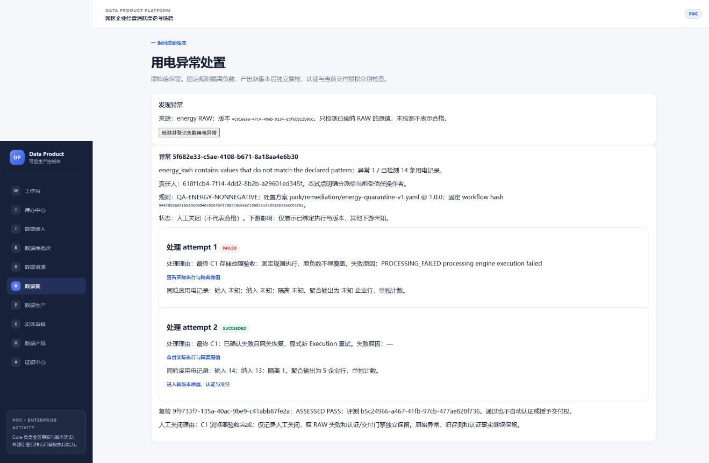
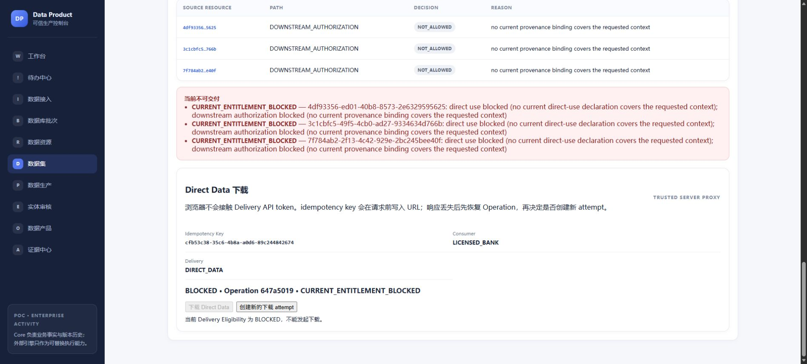

# #299/C1: negative-energy remediation

## Finite contract

Base: main `21762737a76033667df4a138368070868a34fbf8` (includes #309). One writer, branch
`codex/issue299-c1`; isolated synthetic PostgreSQL/Hop/Core/storage/browser runtime.
#307's unmerged 000054 was superseded by main's 000055 (#309); its writer was
notified to reserve 000057. C1 uses 000056. Shared routing/event vocabulary is integrated in independent
candidates and rechecked against main before publication. C1 needs no new cost
allocation subject: existing physical Execution and Quality attempts own costs.
#294/#295 and all retained #298 environments remain with their original owners.

Goal: find an actual negative value in the fixed PostgreSQL numeric text column,
assign it to the authenticated pilot operator, execute the approved existing
quarantine workflow, inspect a new CURATED version and recheck it. Certification
and delivery remain separate existing commands and gates.

Authority: #299/#296, AGENTS, existing workflow/quality/rights/certification/delivery
contracts and industry-pack rules. This document owns only the C1 case association
and its acceptance record. It is not another lifecycle blueprint.

## Reuse check

Existing Native/Hop execution, native regex evaluator, immutable QualityAssessment
and Finding, execution quarantine, attempt costs, idempotency, PostgreSQL locks,
principal/workspace resolver, Audit/Evidence and transactional Outbox are reused.
The RAW-only policy expresses the existing nonnegative-energy rule on PostgreSQL's
fixed numeric decimal text; it introduces no guessed maximum or replacement value.
Output recheck uses the existing complete enterprise-activity quality ruleset.
Existing RAW full-product assessment can fail for unavailable product metrics;
that historical failure alone is not proof that a negative reading was detected.

OpenMetadata already owns quality incidents and a governance workflow framework.
Their integration is an upstream proposed ADR
([official ADR and existing implementation context](https://github.com/open-metadata/OpenMetadata/blob/main/adr-incident-manager-governance-workflows.md)).
Those catalog workflows cannot atomically own Core's immutable version/Execution/
Assessment association. C1 adds only those business facts and the operator path;
it does not recreate a ticket engine, scheduler, evaluator, IAM, alert transport or
approval system. No new dependency/provider or paid service is introduced.

## Required invariants

- Server-authenticated workspace/actor; pilot assignment is explicitly to that
  operator. A descriptive catalog Owner, body actor or arbitrary UUID grants no role.
- Detection records an exact failed Finding, frozen rule hash and source version.
  Same detection key replays the same quality attempt and case.
- Immutable case header, assignment, execution association, recheck start/outcome
  and manual-close facts. Commands lock the case parent first. No PATCH status.
- Approved workflow identity/hash is checked server-side; case input must be one
  exact bound input. Case attempt + existing Execution acceptance and its outbox
  obligation commit atomically. Only one active/latest successful execution; a
  failed execution is retried through the existing explicit retry command.
- Same command replay creates no new execution/cost. A real failed invocation and
  explicit new retry have separate existing attempt costs. Unknown outcomes are
  recovered through existing owners, never blindly restarted by the case layer.
- Recheck pins an explicit successful execution/output and stable quality attempt
  before evaluation. Response loss between assessment and association can replay
  that attempt, including after manual closure. Closure blocks new admission;
  it must not discard recovery of already committed Quality work. New physical
  evaluation uses a new explicit attempt key.
- Manual closure cannot mark Quality PASS or Certification CERTIFIED. Old RAW,
  assessments, certifications and release/evidence history are protected.
- Display energy input/accepted/quarantined records at the same grain; enterprise
  aggregation output rows are a separate grain. Unknown impact stays unknown.
- Repaired/certified output still uses CurrentDeliveryGate; source revocation must
  block fresh delivery from a stale ALLOWED browser page with zero payload.

## Acceptance record

PASS on 2026-10-11, against code commit
`bc62ebfa8846922916cba8bfa195cf6e495592f3` based on the main above. Subsequent
evidence-only commits do not change the candidate API or production web code.
API SHA256: `2633d367b912fcf58e2bda77b10c6aaa567a42948686728e18f68576b3aa3e3b`.
Production Next build, real Edge, PostgreSQL 16, Hop 2.19.0/JDBC 42.7.14,
existing Native processing/quality adapters, Redis 7 and the existing pinned
MinIO/Caddy storage harness were used. Exact images and independent PostgreSQL
results are in [runtime-proof.json](issue299-c1-evidence/runtime-proof.json).

The final environment was freshly installed through migrations 000055 → 000056;
it contains no #307 schema and shares no Core/storage objects with retained #298.
Trial entry: `http://127.0.0.1:52175/batches`; API `http://127.0.0.1:60161`.
The case is now manually closed and its source authorization revoked, deliberately
retaining the final negative-state evidence. Private credentials remain in the
ignored local harness files; none are needed in the browser.

### Real browser and provider results

1. Registered the source, ran real PostgreSQL → Hop extraction, atomically accepted
   all three RAW versions, completed the existing entity review and processing
   path, then obtained a baseline quality PASS and CERTIFIED decision.
2. Created a nonempty PUBLISHED baseline release
   `ec5bbd6c-fa99-4b93-95d5-67bc4dd9147e` with release dataset membership and an
   EvidenceSnapshot before the C1 repair. Recorded exact historical row identities
   and hashes before testing the repair/fault/replay commands.
3. From the energy RAW version, detected one actual negative value among 14 records
   and assigned case `5f682e33-c5ae-4108-b671-8a18aa4e6b30` to the trusted operator.
   Stopped only the owned storage gateway; the actual Native call ended FAILED
   (`b4f7c6a0-b647-444c-8cda-dd2fa77a9049`). Storage itself stayed running.
4. Started the same gateway and explicitly retried. New Execution
   `267bd3e6-1e37-4332-82c6-5167f7cf4d4d` succeeded, with 14 energy records =
   13 accepted + 1 quarantined. Quarantine retained `-999` and
   `NEGATIVE_ENERGY_KWH`; the separate enterprise aggregation produced 5 rows.
   Output version `c64a947d-c2a2-4104-8006-af0c652951e6` is a new CURATED version.
5. Ran the complete existing output quality ruleset through the independent
   recheck: assessment `b5c24966-a467-41fb-97cb-477ae828f736` PASS. Existing
   compliance/evidence preparation and certification commands produced a separate
   CERTIFIED decision. RAW still produced REJECTED, including
   `QUALITY_GATE_NOT_PASSED`.
6. Downloaded the new output through the real browser: 640 bytes, SHA256
   `a2545a5642fbf076840d2b2f03848973e990b0c12de6a7ffcbfc6dd990af0eb6`.
   Kept an ALLOWED browser preflight on screen, revoked the actual source
   Authorization through its existing Command, then submitted that stale page.
   Core recorded BLOCKED / `CURRENT_ENTITLEMENT_BLOCKED`, returning no dataset
   payload. Historical CERTIFIED and the prior ISSUED operation stayed intact.
7. Before manual closure, the independent HTTP/PostgreSQL oracle passed 24 checks,
   including eight concurrent same-key retry recoveries returning one Execution.
   After browser closure, 26 checks passed: new handling/recheck admission was
   rejected, accepted recheck and close keys recovered their existing identities,
   and all those replays produced zero new execution/quality/cost/audit/outbox facts.
   Missing credentials, foreign workspace and changed same-key inputs were rejected.

The real runtime recorded three Native invocation costs (baseline, failed C1 call,
explicit successful retry), including the failed invocation; three actual quality
invocation costs (baseline, detection, output recheck) were retained. Each physical
attempt owns its cost through the existing allocation model. Replay added none.

All 17 original history table sets matched before fault, after repair/replay and
after closure, including nonempty release/evidence membership. Original RAW bytes,
old assessments, certification, rights and published bindings were unchanged.
The existing audited `READY → SUPERSEDED` transition of the old CURATED version is
permitted; the oracle proves its event/audit and compares every other field exactly.
It does not falsely claim that lifecycle projection status never changes.





### Tests and reproduction

- `go test ./...` and `go vet ./...` PASS with the real isolated test PostgreSQL
  DSN, including clean migration installation on a fresh database.
- `go test -race -count=1 ./internal/quality/remediation/... ./internal/platform/routing/... ./internal/workflow/application/...`
  PASS. Real PostgreSQL tests prove eight same-key acceptances, atomic rollback of
  case/Execution/queue facts when proof routing fails, an observed parent-lock wait
  before a late assignment, immutable guards, separate failed/retry costs, failed
  assessment replay, and committed assessment recovery after response loss and
  manual closure. Controlled test adapters are distinguished from the real browser
  runtime above; four controlled physical quality calls include the lost-response
  assessment and do not imply a fourth real browser evaluation.
- Web lint/typecheck and the production build with its existing command tests PASS.
- The browser uses existing B3 fixture Commands for synthetic rights, certification
  inputs and the baseline release; no success/status rows are fabricated by the
  independent C1 oracle. OpenMetadata is an offline projection in this C1 trial;
  #298's real metadata connection/recovery acceptance is not relabeled as a C1 run.

From `apps/platform`, build the API, worker and the existing B3 fixture into the
ignored `.data` directory:

```powershell
go build -o ../../.data/pgi-b3-c1-latest-api.exe ./cmd/api
go build -o ../../.data/pgi-b3-c1-latest-worker.exe ./cmd/worker
go build -o ../../.data/pgi-b3-c1-latest-fixture.exe ./cmd/ingestion-browser-fixture
```

From the repository root, start a new isolated production browser runtime. The
cache can reuse an existing official MinIO build; it owns no historical Core facts.

```powershell
python examples/enterprise-activity/postgres-ingestion/b3_runtime.py --output .data/c1-trial --binary-prefix pgi-b3-c1-latest --remediation-plan-ref park/remediation/energy-quarantine-v1.yaml
```

Follow the browser actions above. After a baseline release exists, capture the
history before C1. After the real download and revocation, compare the same history:

```powershell
python examples/enterprise-activity/postgres-ingestion/c1_verify.py --runtime .data/c1-trial/runtime.json --output .data/c1-trial/history-before.json
python examples/enterprise-activity/postgres-ingestion/c1_verify.py --runtime .data/c1-trial/runtime.json --previous .data/c1-trial/history-before.json --download <actual-browser-download> --output .data/c1-trial/verified-final.json
```

The harness outputs actual localhost URLs; their ports and UUIDs will differ in a
fresh trial. Stop only a trial's owned gateway for the failure, preserve storage,
and use the explicit retry after recovery. Do not reuse the accepted same-key
download for payload recovery; it must remain a non-payload replay result.

Blockers: current C1 path failure, security/tenant bypass, mutable/lost historical
facts or costs, non-atomic acceptance, duplicate real work on replay, concurrency
violating these invariants, required build/test failures.

Follow-ups: #299/C2 source schema observation, multi-operator IAM/assignment,
generic incident/notification UX, full downstream impact, schedules and production
rollout. #298 human explanation remains deferred/NOT_RUN. C1 does not close #299,
does not pass C2/human acceptance, and its PR remains Draft without automatic merge.
