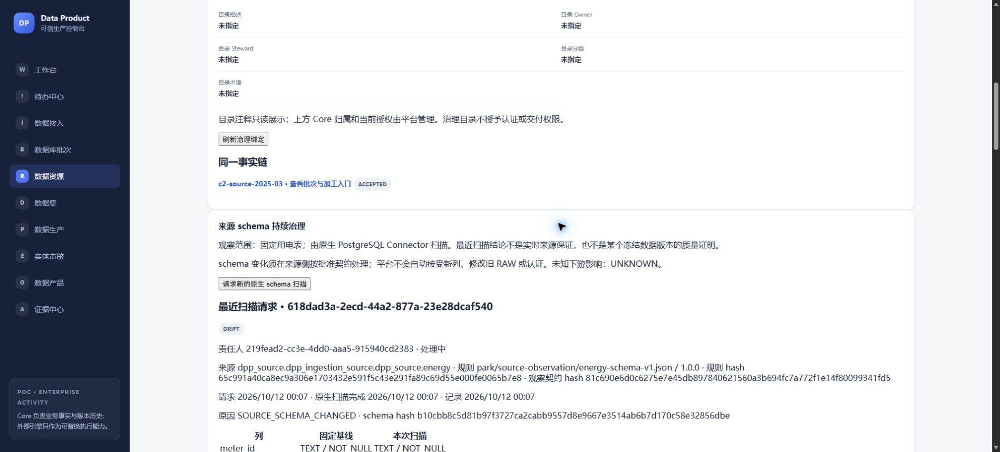
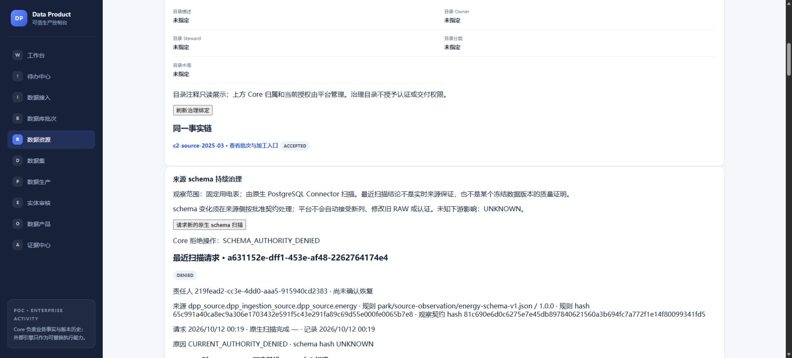
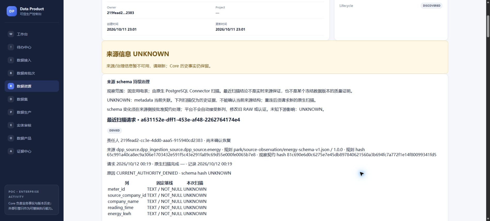
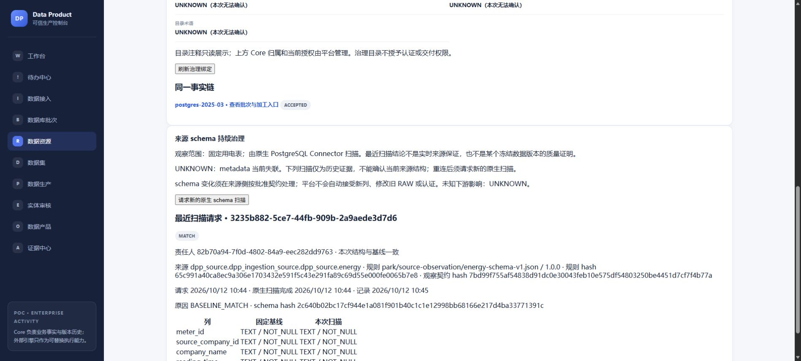
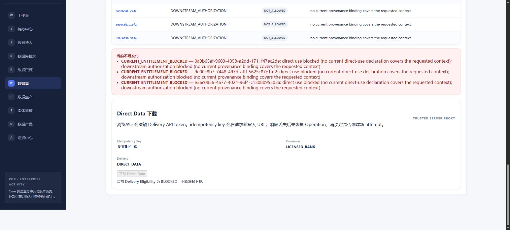

# #299/C2：固定用电表的原生 schema 观察验收

**2026-10-12 原试用事故：FAIL / NOT_RESTORED。** 原合成 Core
`dpp-pgi-b3-core-bc776a791192` 使用 256MiB tmpfs。本轮错误地在同一实例建立
review/组合测试数据库，耗尽空间（SQLSTATE 53100），PostgreSQL 恢复 checkpoint
失败并退出，原数据库事实丢失。用户确认没有完整备份；部分 JSON/hash 无法恢复全库。
原 Core 不重启、不重建、不重新播种；原历史在线访问不可用。本文先前的浏览器和历史
保护 PASS 仅证明事故前对应时点，不代表目前历史仍在线保留，也不能用新库 PASS 抹去
此次 FAIL。[事故证据](evidence/issue299-c2/review-core-incident.json) 保留退出时间与日志 hash。
旧容器、其他数据卷、对象和备份不删除。后续独立验证库或新合成试用均不是旧历史恢复。

Goal: one PostgreSQL energy-table schema baseline, real native discovery,
drift explanation, disconnect and recovery in the existing source detail.
Authoritative scope: #299 and the approved C2 instruction. C1 facts remain owned
by the existing remediation/Execution/Quality/Certification commands.

Reuse: existing OpenMetadata Adapter/metadata Port, native PostgreSQL ingestion
package matching server 2.0.5, transactional outbox/worker, PostgreSQL locks,
CurrentEntitlementGate, Audit/Evidence and typed CostAllocation. No connector,
second scheduler, catalog, generic notification or ITSM implementation is added.
An isolated CLI launcher replaces the need for an additional Airflow scheduler.
The package's CCLA is recorded honestly; this trial is not commercial licensing
or production deployment approval. See the official PostgreSQL connector guide.

Invariants: source discovery is distinct from catalog health/revision and frozen
DatasetVersion QA. Request/physical attempt/observation/handling history is
append-only; same request and successful outbox replay do no new work; actual
retry invocations have independent cost identities. Current source entitlement
is checked before scanning and before accepting the observation. Manual handling
never changes QA, certification, release, or delivery gates. The fixed ingestion
schema contract is not widened automatically. Unknown downstream impact stays
UNKNOWN. Source credentials remain private to the adapter.

Coordination: #307/D1 owns migrations 60–64, now merged via #314 at
`c1a3463ee110e3cb7dadb0004b0942c001f19ffe`. C2 owns 65–66;
order is main 59 → D1 60–64 → C2 65–66. C2 uses
independent metadata files while migration and shared composition/routing order
is coordinated. Existing environments and volumes are retained.

2026-10-11/12，基于 main `1892cd76c4ee578896ddfb3c6f4a7252bfacc51b` 的隔离环境，技术验收 PASS。
人工解释按用户要求 **NOT_RUN / 暂缓**。提交 Draft；不关闭 #299、不自动合并。

**实际 rebase 阶段检查（2026-10-12）：已实际 rebase main `c1a3463e`。**
源码直接取自 Git `a793f237`，真实 PostgreSQL 全模块 `-race`、vet、fresh66、
main64→66、空 66/65 down/up、含事实 down 拒绝和共享注册均 PASS。
Edge 使用该 API/生产 Next，核对三 RAW/manifest、原加工/质量/认证历史、撤权扫描
拒绝和交付禁用、metadata HTTP 503 的 UNKNOWN 提示及恢复 OBSERVED。
192 Core 表前后精确 hash 相同（含两份 PUBLISHED release），零新扫描/成本。
这是当前代码的读取/拒绝/失联回归；没有重新授权或重新执行 native happy path。
[实际 rebase 证据](evidence/issue299-c2/actual-rebase-main64.json)。新 HEAD CI/评审另行核对，
仍 Draft、不自动合并；原事故 NOT_RESTORED 与人工解释暂缓不变。

**组合源码绑定更正：** 私有 `combo-ready-epoch66625210-source` 曾标注 D1 `66625210`
+ C2 `f8404f01`，实含旧 D1 的 early-recovery、30s task budget 和 migration64 terminal
规则。旧日志只证明该混合快照，不证明标注的最终组合，不计当前候选 PASS。
原回执保留；当前证据来自实际 rebased Git，D1 lifecycle/60–64 与 main 精确一致。
这不改变独立核对的 #314 精确 candidate/tree、PR CI/评审及对应 main CI，也不把
旧阶段 native/browser 结果重标为当前代码。[更正说明](evidence/issue299-c2/source-binding-correction.md)。

最新复评发现 RUN 启动交接仍有授权竞态；该阶段 CI PASS 不抵消 blocker。
修复后的当前代码和验收见本文末尾“RUN 与撤权的串行交接”。

## 实际证据

[runtime-verification.json](evidence/issue299-c2/runtime-verification.json) 保存精确 IDs、时间、列、
typed 成本、历史 count/hash、运行二进制 hash 与 D1 migration 文件 hash。来源是
`dpp_source.dpp_ingestion_source.dpp_source.energy`，规则为行业包
`park/source-observation/energy-schema-v1.json` / `1.0.0`，五个 TEXT / NOT_NULL 列。

| 检查 | 实际结果 |
| --- | --- |
| 原生发现 | 未修改的 MetadataWorkflow 读取真实 PostgreSQL，五列 MATCH；不是手工创建目录表或伪造状态 |
| schema 漂移 | 合成来源真实 ADD COLUMN `schema_probe text`，原生扫描 DRIFT；Edge 显示差异、责任人、规则版本/hash、时间/范围和处理理由 |
| 处置边界 | 浏览器记录 INVESTIGATING；仅来源侧在 probe 全 NULL 时恢复批准的五列契约；未改旧 RAW/质量/认证/发布 |
| 抽取 contract | 漂移时既有 Hop Prepare 返回 AUTHORITY_DENIED，无新增 Operation/RAW；固定 contract 未自动扩大 |
| 断连、恢复 | 本切片 OM stop/start；浏览器 STALE/UNKNOWN，历史不冒充当前健康；同一请求 4 次 UNAVAILABLE → MATCH |
| 重试成本 | 上述请求 5 次实际 native invocation，各有独立 CostEvent/typed allocation；不是按顶层 request 去重后吞掉重试 |
| 崩溃恢复 | attempt/cost 已落库且 scanner 正在运行时终止本切片 Worker；恢复先 containment，再追加 INTERRUPTED，同请求后来 MATCH；旧 start/cost 保留 |
| 幂等 | 8 个并发 same-key请求及 8 个 handling 重放，各保留一份事实；改变同-key reason 拒绝；零新增事实/成本 |
| Worker 并发 | 两个升级 Worker 各处理一个不同请求，同来源扫描区间不重叠、均 MATCH、分别计费；最终组合复验仍串行，复验对由同一 secondary Worker 调度，未冒充跨 Worker 争锁证据 |
| 隔离 | dpp_reader 可 SELECT，不能 INSERT/UPDATE/DELETE/CREATE schema；scanner 只挂载自己的只读 YAML，未挂载 Core/Hop/operator 凭证；5 个密钥未出现在 Core/cost/audit/evidence/outbox |
| 撤权扫描 | 先接纳请求、暂停本切片 Worker、走既有 RevokeAuthorization、恢复 Worker：DENIED 且 0 physical attempt；新请求、旧成功 key/handling 重放均 403，零新事实/成本 |
| 用户闭环 | Edge 从来源/批次进入实体审核、既有加工、质量/Compliance、独立认证和下载；5 行/640 B 实际下载 hash 与冻结版本一致；负数 RAW 仍 REJECTED |
| 撤权交付 | 浏览器先加载 ALLOWED，撤权后下载产生 BLOCKED / CURRENT_ENTITLEMENT_BLOCKED；同-key页面恢复展示 BLOCKED；两个旧 ISSUED 和旧 CERTIFIED 保留 |
| 历史保护 | 17 个非空历史表精确 membership/content hash 不变，包含 2 个真实 PUBLISHED release；projection 最终 PUBLISHED，故障发布实际重试 7 次 |
| PostgreSQL | 并发 request/cost、跨 workspace/actor 拒绝、immutable guards、primary/外部 ID 绑定替换拒绝、populated down fail closed 均 PASS |

分阶段 artifact hash 如实保留：DRIFT、断连/恢复、跨 Worker 争锁发生在前一组合。
最后 Go 改动只增加当前 primary binding 在 RUN 前和接收结果前仍匹配的要求；
最终组合实际跑了新 native MATCH、双 Worker 串行扫描、撤权排队拒绝、浏览器下载/阻断，
并用真实 PostgreSQL 验证绑定替换拒绝；未把旧组合的 hash 标为最终 hash。
版本校验错误、失联、token 到期和 Worker 崩溃的历史均保留。凭证刷新仅轮换同一隔离 OM 账户既有访问。

## 复用、迁移与部署边界

既有目录 GetTable 只说明目录响应，不能证明刚扫描来源，因此通过现有 Adapter 的 SourceSchemaObserver
Port 调用原生包，要求本轮原生迭代器恰好输出一次精确表、全部步骤无 failure，
再核对 catalog 身份及列与本轮记录一致。成熟方案是
[OpenMetadata 原生 PostgreSQL Connector](https://docs.open-metadata.org/v2.0.x/connectors/database/postgres/yaml)；
未自建 Connector、第二套 Airflow/Temporal、告警或 ITSM。部署成本为已有 OM + 有时限的临时 scanner。
安装分发版本实际 **2.0.5.0**，按 PEP 440 规范化等价校验 contract 2.0.5。
分发包 license metadata 是 **Collate Community License Agreement 1.0**，不能写成 Apache；
本次本地技术接入不声明生产/商业 license admission 已通过。

#307 writer 确认 D1 60–64 与 C2 65/注册文件的写域；C2 未修改 D1 checkout。
自己的独立 PostgreSQL 按 D1 文件快照 60–64 → C2/65 真迁移，
[postgres-after-d1.log](evidence/issue299-c2/postgres-after-d1.log) 与 JSON 内 10 个文件 hash 可复核。
empty C2 down/up 保留 D1 cost subjects；populated down 在排他锁内拒绝并保持事实。
**Ready 前须按实际 D1 → C2 合入顺序 rebase、核对迁移号/共享注册、重跑组合迁移。**
不能先在 main 安装 65，再指望 runner 补跑较小的 D1 60–64。

真实运行发现原 routing_version + governance 超过 DB varchar(64)，已改短版本并在 NewRouter 校验。
使用专有 frozen handler `source-schema-observation`，避免旧 metadata handler 忽略新 event 却 ACK。
**启用 C2 profile/API 前须升级所有消费该 Outbox 的 Worker**；旧 Worker 缺少 handler 时明确失败。
本切片原 keeper Worker 已暂停以保留 provider ownership，仅新 Worker 消费 C2。
停止试用给最新 recompose output 写 `STOP` 文件，只关闭本组合 API/web/worker，保留原 runtime 容器/volume。
恢复旧 Worker 前先停止新组合并确认无 C2 待处理事件，不让旧 Worker 消耗新事件重试预算。
OM stop/start、scanner `--rm`/containment 只作用于本切片具名对象。Compose start 同时触发其
depends_on 的保留 execute-migrate-all，一次性服务退出 0，时间/trigger 见 JSON；未 down -v 或清理其他任务环境。

## 复跑与校验

复用 examples/enterprise-activity/postgres-ingestion 的 B3 fixture/runtime。
`Dockerfile.metadata-ingestion` 安装匹配原生包；`c2_runtime.py` 建自己的 source/Hop/Core；
`c2_connector_config.py --runtime ... --metadata ...` 生成私有 native YAML 与冻结 plan。
编译 `.data/pgi-b3-api-c2-final.exe` / `.data/pgi-b3-c2-final-worker.exe` 后用 `c2_recompose.py`，首次不加 reuse-build。
Edge 使用输出的 loopback URL，成功必须真实产生后再用 `c2_verify.py` snapshot/stress/concurrent 复核。
outage 用本项目 server stop/start；恢复等待既有 Outbox backoff，dead letter 只用既有 outbox-replay Command，
不直接 UPDATE queue。撤权最后执行并保留撤权状态。

go test ./...、go vet ./...、metadata/Outbox/routing race、web typecheck/production build、
真实 PostgreSQL integration、Edge 均 PASS。普通 go test 的 DSN 未配置 integration SKIP 与单独真实 DB PASS 分开记录。
人工解释、生产部署、全面血缘、实时新鲜度 SLA、自动 schema 接纳、通用告警/审批及商业 license admission 未声明完成。

Non-goals: live-source freshness SLA, full lineage, generic alerting/approval,
multi-operator IAM, production rollout, automatic schema acceptance or repair.

## PR #313 评审修复复验（2026-10-12）

修复两条有效意见：零目标表发现不能把旧 catalog 认作本轮 schema；配置读取故障不能
变成 terminal DENIED。Adapter 只观察原生 CreateTableRequest 并原样传给原生 sink，
不实现 PostgreSQL 发现逻辑。已加载但 disabled、语义无效或与冻结 plan 不符仍拒绝；
文件/解析/基础设施读取失败返回 retryable error，不 ACK 成功或永久拒绝。

[review-native-target.json](evidence/issue299-c2/review-native-target.json) 记录本次修复文件 hash：
新建独立空合成来源，真实原生 Connector 健康扫描五列；将其表改名后，即使
markDeletedTables=false 留下同一 catalog 实体，Adapter 退出 1 且不输出结果；
恢复原表名后返回原实体 ID/五列。另有原生 SDK contract tests 覆盖空/错表、sink failure
及 source/catalog 列不一致。该证据只证明 Adapter contract；未重新授权原已撤权来源，
未把它当作新的浏览器或 Core 权利验收。

[review-d1-combination.json](evidence/issue299-c2/review-d1-combination.json) 与
[review-postgres-race.log](evidence/issue299-c2/review-postgres-race.log) 对应 D1 已提交
`2cb3c96dc6cb842cd7c57174ee35fc7107d31a30` 的精确 Git blobs。在自己的新库真安装
main 1–59 → D1 60–64 → C2 65，empty down/up 保留 D1 cost guard，populated down
拒绝且七表 count/hash 不变。真实 PostgreSQL 回归证明同一请求在 profile 读取故障时
无 terminal observation/扫描，恢复后 MATCH、一次扫描/成本，成功重放无新增；已加载
disabled plan 仍 DENIED。此回归使用受控 Observer/entitlement Port，不代表外部 provider
或真实权利已获验收。go test ./...、go vet ./...、上述 PostgreSQL race 与 native SDK 四项
回归均 PASS；普通 Go suite 的 integration SKIP 仍与专门真实 PostgreSQL PASS 分开。

#307 writer 已确认 D1 → C2，不占用 C2 路由/Worker 写域。本次组合证明只绑定上面的
已提交快照；#307 正在补 processing/delivery pin，并计划更新未发布的 64。若最终
D1 新增独立迁移达到 65 或更高，C2 writer 将把自己的迁移排到其最终最大号之后。
Ready 前必须按最终 D1/main 快照 rebase 并重跑组合，不能以本次旧快照替代最终门禁。
本轮保持 Draft、不自动合并；人工解释继续 NOT_RUN。

复评另两条有效意见已补：最终 exact binding 检查持 tuple FOR UPDATE 直到观察提交，
binding repository 按 resource → binding 锁顺序更新；真实 PostgreSQL 观察先行时
refresh/demotion 和 direct identity UPDATE 均等待，mutation 先行时追加 DENIED，旧 MATCH
历史保留。扫描配置或 OM 被禁用后，HTTP 仍查询历史，仅 enabled=false；真实 PostgreSQL
HTTP 回归保留 request/DRIFT/handling，并拒绝匿名及 foreign workspace。
[review-binding-history.json](evidence/issue299-c2/review-binding-history.json) 和
[review-binding-history-postgres.log](evidence/issue299-c2/review-binding-history-postgres.log) 保存修复文件 hash/日志。

本轮 CI 的 live-core 在既有 T3/B2 down guard 争锁测试发生 SQLSTATE 40P01；该测试原先
对共享 DSN 取多表排他锁，会与其他并行 package 互相阻塞。现复用已有 scratchDatabase(t,18)，
保留真实 business/down 并发断言，-race 连跑 5 次 PASS，生产 down/runner 不变。
独立真实 B2 复跑 PASS；本机默认 Docker 地址池耗尽，wrapper 仅为本次两个新临时网络
分配经 inventory 确认不重叠的 10.233.23.0/24、10.233.24.0/24，cleanup PASS。旧 CI B2 的实际断言日志
未上传，不能据此声称已证明环境偶发；harness 已在密钥检查通过后输出有界失败明细。

**D1 `2cb3c96d` 全组合回归 FAIL：** 在新库以 TEST_POSTGRES_DSN 执行全模块测试，
metadata/迁移及其他 packages PASS，但 externalintegration/integration 失败。D1/60 重建
CostAllocation single-subject constraint 和 workspace guard 时漏掉 main/57、58 的
external_provider_call_id / external_usage_call_id，导致既有调用成本不能落库。已交 #307
writer 修正其未发布 60 up/down；C2 不在 65 中补漏以掩盖依赖缺陷。本 PR 自身的
main + C2/65 新库全模块 PostgreSQL 回归 PASS。前文 D1 的安装、source-schema 和 empty/
populated down PASS 只证明对应局部检查，不能代替全组合回归；Ready 仍须等待 D1 稳定
修复快照后重跑。原 Core 撤权事实及人工解释 NOT_RUN 均保留。

最后一条复评补齐 frozen connector contract：Application 接收结果时还要求
result.ConnectorHash == request.Plan.ConnectorHash，不能只相信 Adapter 自己加载的配置。
真实 PostgreSQL + 受控 Port 模拟两次 gate 均见 A、结果却来自 B 或缺少 hash，均保留
UNAVAILABLE/调用成本；恢复 A 后同请求 MATCH，共两次调用/两份 typed 成本，成功重放
无新增。metadata -race、go test ./...、go vet ./... PASS。证据与实际文件 hash 见
[review-frozen-connector.json](evidence/issue299-c2/review-frozen-connector.json)。

成功 Scan 的 Port contract 明确为原生发现完成且进程已退出（现有 Adapter 已用成功
cmd.Wait 证明）；Application 不再执行第二次 Stop，避免读取配置失败丢弃有效结果。
失败/未知扫描及 crash recovery 仍必须确认 Stop。真实 PostgreSQL/受控 Port 回归证明
成功时 cleanup profile 不可读仍 MATCH、一次 attempt/成本、重放无新增；未知完成且
containment 失败时不接受结果，确认停止后保留 INTERRUPTED 再复扫，成本逐次保留。
metadata -race、go test ./...、go vet ./... PASS，精确 hash/日志见
[review-completed-scan.json](evidence/issue299-c2/review-completed-scan.json)。

页面现在独立渲染 Core schema 历史，live metadata 只决定当前提供方可用性；来源/批次
查询失败也不能跳过历史。以最新修复编译生产 Next/API，在保留的真实 Core 上禁用
OM/schema composition，并用仅允许 GET 的 loopback proxy 注入 metadata 503，再同时
注入 source/batch 503。真实 Edge 两种情况下均显示 17 个请求、旧 DRIFT 处置与 UNKNOWN
提示，扫描按钮不存在；未请求新扫描、未放宽权限。17 个非空历史表、四个 source-schema
事实表及 24 份 invocation 成本精确 count/hash 不变；原来源授权仍 REVOKED。
[review-ui-history.json](evidence/issue299-c2/review-ui-history.json) 保存实际 binary/input hash、
故障路径、前后 hash 和页面结果。此次仅停止自己的 review API/web/gateway，原 runtime 保留。

最终 binding 检查也保留具体失败来源：扫描期间 binding demotion 时记录
DENIED / SOURCE_BINDING_CHANGED，而非 CURRENT_AUTHORITY_DENIED。真实 PostgreSQL
回归验证同一 reason 进入不可变 observation、Audit 与 Evidence。go suite/vet、metadata
PostgreSQL -race、web typecheck/production build、上述真实 Edge 检查均 PASS。

## 最终组合与独立持久化新基线（2026-10-12）

八条有效评审意见已修复并回复、解决原线程。完整源码组合绑定 D1 `b853466f` 与
C2 Go/UI `00bd4d4e`，在独立 named-volume PostgreSQL 上执行全模块 `-race`、vet、
Worker/Outbox/routing 注册，均 PASS。两处共享注册冲突只在 scratch archive 解决，
保留 lifecycle recovery 与 source schema，providers=5 / no-provider=3；版本为
`c1-v27+ext1+exec1+usage1+rem1+life2+schema1`。D1 后续 `f1b4b962` 仅提升共享挂载
helper/test，`fcef3dd2` 仅文档/证据，生产 Go/60–64 SQL 与前一测试快照不变。
main 已安装 59 → D1 60–64 → C2 65 真升级 PASS（56 条既有 migration membership
精确 hash 不变；版本号存在空缺，不能把 max(version) 当 count）。成本 guard 保留
main external provider/usage、D1 两个 subject 和 C2 subject；空 65 down/up PASS，
有事实 65 down 拒绝且七表 count/hash 不变。精确 Git blobs、60–65 SHA、共享源码和日志
hash 见 [最终组合证据](evidence/issue299-c2/review-final-d1-combination.json)。
实际 D1 → C2 合入/rebase/注册整合与当前候选 CI/评审仍需分别核对；scratch PASS 不能
代替 Ready 或 main CI。本轮继续 Draft，不合并。

用户另行批准的新合成基线 run_id=`4a6f20ee-0b8e-4820-835a-3d5b622b2410`，使用
独立 10.233.26/27/28.0/24 网络和 loopback 入口。Core、source PG、MinIO、Redis
均使用已登记的独立 writable named volume；Hop files/tmp/staging 与配置也保留。
复用 D1 `Assert-RetainedServiceStorage`，真实 create→inspect→preflight→start→running
复核，拒绝 tmpfs、nested/WAL、错 owner/角色/卷；4 正例、19 负例及实际四角色 PASS。
Redis AOF=yes / appendfsync=always。STOP/supervisor 退出仅停止自己的进程和容器，
不 rm、删卷、删网络或清配置；`b3_resume.py` 复用原容器/端口，不 bootstrap。
PostgreSQL readiness 使用最终 TCP server，避免误认初始化阶段的 Unix socket。
原先扫描命令的前五个临时容器沿用 `--rm` 已自动移除；此后 native scanner 也改为
保留，containment 仅停止进程，两份后续失败/成功容器与日志已保留。该有限差异如实
记录，不声称全部扫描容器均保留；没有删除新旧 retained service、数据卷或原生对象。

真实 Edge 在 production Next bundle 上走完新批次三份 RAW、实体审核、既有加工、
质量/Compliance、独立认证和实际下载。5 行/640 B 的 SHA256 与冻结版本一致，
`-999` 原值留在 RAW/隔离历史；原始负数规则 FAIL 后认证 REJECTED，新 CURATED
QA/Compliance PASS 后 CERTIFIED。metadata 断连时 UNKNOWN + 历史 MATCH 可见；
同请求保留五次 UNAVAILABLE 后 MATCH，共七次真实扫描/七份 typed 成本，失败发布
投影第六次尝试 PUBLISHED。先前 release 的 17 表精确 membership/hash 跨断连/恢复
不变；第二个 release 与全部新增事实另由全库备份、恢复及 stop/start 保护验证覆盖。
八个并发成功 key 重放零新事实/成本，撤权后新/旧 scan key 403；浏览器下载禁用，
同页面 key 的独立 API negative command 再验证 server gate BLOCKED、零 dataset bytes，
旧 ISSUED 与 CERTIFIED 不变。此处没有把 API negative command 写成浏览器实际下载。
见 [新基线浏览器证据](evidence/issue299-c2/new-baseline-browser.json)。

复用 `Documents/Codex/2026-10-11/task-2` 的现有 backup/restore tools，仅适配新 group、
输入路径及凭据引用；使用标准 pg_dump custom/globals、原生对象 physical archive /
all-version read、Redis RDB/AOF 和文件 archive，未造第二套备份框架。Core 191 表
787 行、source 3 表 30 行逐表 count/hash 全恢复；8 个原生版本的 version ID、size、
payload SHA256 完全一致。两份独立 PG 副本使用备份内凭据，通过原 role/owner/ACL
和真实 pgx fresh connections；原 Core/publisher 对象凭据在有效期内通过恢复副本的
允许/拒绝范围检查，有限 STS 到期保留，不能把历史认证测试称为凭据永久有效。
OpenMetadata 三库也用原 PG15 镜像全恢复，201 表/3291 行、DB/function/extension
owner/ACL 与真实 SCRAM（错误密码拒绝）PASS。初始 PG16 restore 的行内容 PASS
不足以证明完整 owner/auth，初始化 race 失败也保留；最终证据只取原镜像完整复核。
凭据、dump、完整配置、staging、精确源码/二进制和 native logs 在 ACL 保护的本地
备份内，不提交 Git 或输出 secret。详见 [完整备份恢复](evidence/issue299-c2/new-baseline-backup-restore.json)。

关闭本轮应用后，服务单独启动作 quiescent backup；再停止/启动新六个容器，Core
191 表和 source 三表仍精确匹配全库备份，8 个对象版本不变，Redis 四个 persistent
key 的 DUMP hash 一致（RDB 另含正常会到期的 heartbeat key）。容器、六卷、配置、
网络及恢复副本均保留，见 [保留式重启](evidence/issue299-c2/new-baseline-retention.json)。
新的 loopback 页面是新合成基线；当前来源授权已 REVOKED，交付阻断是预期门禁。
原事故历史继续 FAIL / NOT_RESTORED / 不可用；人工解释 NOT_RUN，生产与商业 license
admission NOT_RUN。新库通过不能收回原事故 FAIL，也不能直接关闭 #298/#299。

最终复评补齐停止 deadline：原 Docker grace=20s 超过 NativeSchemaObserver.Stop 的
10s deadline，忽略 SIGTERM 的扫描无法及时确认 containment。配置改为 5s，保留
原 10s 外层上限和 fail-closed 规则。真实 Docker + 实际 NativeSchemaObserver.Stop
复现 red：10.009s 返回 unconfirmed、容器仍 running；green：5.631s 确认停止且
容器退出，两个测试容器都保留。独立 PostgreSQL/受控 Observer Port 另验证只有
确认 containment 后才记录 INTERRUPTED 并恢复扫描；该 Port 测试不是原生发现验收。
证据：[停止时限](evidence/issue299-c2/review-stop-deadline.json)。

## 配置轮换后的原 attempt containment（2026-10-12）

复评发现当前 profile 被轮换后，恢复时读取新的 stop template 可停止错容器，并错误
地记录 INTERRUPTED。修复复用既有 attempt、PostgreSQL、Port/Adapter：调用前把
Adapter 的无 secret 启动/停止契约与 hash 同事务冻结到 attempt；Scan 和 Stop 均使用
该份契约，不再为旧 attempt 读取可变 profile。Core 仅持有有界 opaque engine extension，
不依赖 Docker/OpenMetadata SDK。实际 launcher 参数只包含私有凭据文件引用，public
HTTP history 不输出契约。migration 66 以 deferred constraint 保证新 attempt 同事务
具有契约，禁止 UPDATE/DELETE；缺失或 hash 不符的 pending contract 保持 fail closed。
当前保留库的七份 terminal attempts 不被回填或伪造启动事实。

真实 Docker + NativeSchemaObserver.Stop 在当前 profile 指向不同、不存在的容器时，
仍按冻结契约停止原扫描容器，5.477s 确认退出，容器保留。Adapter 单测验证 profile
轮换、损坏、JSONB key 重排后仍用原契约，Scan 也保持原 launcher。独立 PostgreSQL
验证契约冻结、缺失契约 commit 拒绝、空 66 down/up 与有事实 down fail closed。
D1 `fcef3dd2` + C2 本轮全部 Go/66 的完整源码组合，再次执行全模块真实 PG `-race`、
vet 和两类 Worker/Outbox 注册，均 PASS；源码 manifest、关键文件/SQL/日志 hash 见
[冻结运行契约](evidence/issue299-c2/review-frozen-runtime.json)。不是仅重用旧组合 PASS。

新基线关闭本轮进程后只追加 66。全部既有业务表 count/hash 不变；新表为空，七份
原扫描历史不变。新完整 custom dumps/globals、原 owner/ACL 和备份内原凭据的独立
真实 pgx 认证 PASS（Core 192 表/788 行，source 3 表/30 行）。补充备份含当前私有
配置、精确组合源码与新 API/Worker；8 个原生版本 ID/size/payload SHA256、Redis/Hop
独立恢复 PASS。新六服务再次 stop/start 后全库匹配该备份、对象不变、四个 persistent
Redis key 的 DUMP hash 相同。前一时点的完整 OpenMetadata 原镜像恢复及有效期内 STS
权限证明保留；原 STS 自然到期，没有放宽或重授 Core 权限。见
[66 后备份与重启](evidence/issue299-c2/new-baseline-runtime66-backup.json)。

实际 Edge 使用新组合 API binary 核对原三 RAW/manifest、加工结果、metadata OBSERVED
与历史 MATCH/UNAVAILABLE。真实点击新扫描被 SCHEMA_AUTHORITY_DENIED 拒绝；产物
CurrentCertification 仍 ALLOWED，CurrentEntitlement BLOCKED、下载禁用。前后全部
192 表精确 hash 不变，零新工作/成本。此阶段是最终修复后的读取与拒绝回归；前一阶段
真实成功扫描、认证与下载绑定其原 binary，不通过重新授权冒充本阶段 happy path。
见 [最终代码浏览器回归](evidence/issue299-c2/new-baseline-runtime66-browser.json)。

保持 Draft，不 Ready/merge/关 Issue。D1 60–64 实际先合入、C2 rebase 与共享注册整合
仍是后续 Ready 门禁。原 Core 继续 FAIL / NOT_RESTORED，人工解释继续 NOT_RUN。

## 标记前启动失败的成本（2026-10-12）

后续复评发现 cmd.Start 成功后、协议 marker 到达前退出/超时/输出损坏会漏记启动成本。
该意见属于既有 per-attempt Cost invariant 的 BLOCKER。修复将 Port 的进程启动记账
与来源 I/O 验权分开：成功 Start 后立刻持久化同 attempt 的 invocation；marker 必须
匹配冻结目标，然后在发送 RUN 前另做 fresh authority/binding gate。Start 本身失败
不计 invocation，已启动但不能证明 marker/成本或当前权限时不允许 RUN。

实际 OS process/NativeSchemaObserver 回归的 RED 为退出、挂起、损坏 marker 三种
成本均 0；GREEN 每种启动成本为 1、source-I/O gate 为 0。不存在的 executable Start
失败为零成本；cost commit 失败及 startup 后授权拒绝均不能 RUN。独立 PostgreSQL
验证失败 startup 的 typed CostAllocation、同 attempt 两次 ChargeScan 重放去重、
下一次真实重试新增成本、成功 request replay 不增工作，以及 startup 期间 binding
变化后仍阻断来源 I/O。此处不是原生 discovery 成功验收，不混用受控 Port 结果。

最新完整 D1 fcef3dd2 + 本轮 C2 Go 源码再次通过全模块真实 PostgreSQL -race、vet、
metadata 专项及两类共享注册，source/日志 hash 见
[启动失败成本](evidence/issue299-c2/review-startup-cost.json)。migration 不再追加，仍 66。
新 API/Worker 与完整源码、配置追加到已有完整 66 版备份的独立 code supplement，
原快照保留。最终新进程真实 Edge reload、点击 scan 仍被撤权拒绝，metadata OBSERVED
与原 MATCH/UNAVAILABLE 可见，交付 BLOCKED、下载禁用。Core 192 表、source 三表和
8 个原生对象版本完全匹配已独立恢复的备份，零新工作/成本；没有通过重新授权伪造
新的成功扫描或下载。当前 HEAD 的 CI/复评单独核对；Draft、人工解释暂缓及原 Core
NOT_RESTORED 的边界不变。

## 原生启动凭据与成本恢复（2026-10-12）

复评的 P1 指出启动后记账事务失败/worker 崩溃仍可永久漏账。根因是旧路径只靠
进程 callback，恢复没有 durable provider start receipt。修复复用 Docker 原生保留
状态和现有 Core attempt/runtime、ChargeScan、Worker/Outbox：先创建**未启动**的
runtime，在调用前将精确 container ID 与启动/停止/探测契约冻结到同一 attempt；
启动后从该 ID 的持久 STARTED 记录确认 native invocation，在读取 marker 前记账。
RUN 前的 fresh authority/binding gate 保留。没有新增队列、账本、文件 journal 或 migration。

成本未确认时保留 pending attempt，不追加会使它退出恢复集合的 observation。恢复先
确认 containment，再读取被冻结 ID 的 native start receipt，按同 attempt 去重补账，
之后才记录 INTERRUPTED/继续新扫描。已知启动且当前 cost commit 失败时，只重试同
一 ChargeScan；数据库仍失联则继续 pending。CREATED 且未启动的原生凭据明确为
零调用，不伪造成本；凭据缺失/删除/失联则 fail closed。当前 profile 轮换不会更换
旧 container ID、stop 或 probe。Core 将这些作为 opaque Adapter extension，不依赖 SDK。

真实 Docker + 独立 PostgreSQL 跑通三个场景：创建后 launch 前中断，旧成本 0/新调用 1；
native STARTED 后 cost commit 前中断，恢复旧成本 1/新调用 1；实际 PG 拒绝成本写入时
零 observation、保留 pending，数据库恢复后补旧成本 1、下一真实调用 1。各场景成功
重放不增成本/工作，六个真实容器停止并保留。受控 Port 的 PG 回归另证明未知凭据不能
落结果或启动第二次扫描。Docker scanner 是 network-none 的受控 schema 协议，只证明
原生启动凭据和 Core 成本恢复，不冒充 OpenMetadata/PostgreSQL discovery 或真实授权。

最新 D1 fcef3dd2 + 当前 C2 完整源代码真实 PostgreSQL 全模块 -race、metadata 专项、
vet、两类共享注册再次 PASS。最终新 API/Worker 实际重启，真实 Edge reload/点击新
scan 仍被撤权拒绝，交付 BLOCKED、下载禁用；192 Core 表、三 source 表与 8 个对象
版本仍匹配已独立恢复的完整 66 版备份。新源码/二进制/配置追加到私有 code supplement，
原快照保留；例行 metadata credential refresh 未改变身份、权限、duration 或 connector
hash。详见 [成本恢复证据](evidence/issue299-c2/review-cost-recovery.json)。

当前 HEAD CI/评审单独核对。保持 Draft，不合并；实际 D1-first 合入/rebase 仍后置，
原 Core NOT_RESTORED、人工解释暂缓和生产/商业 admission NOT_RUN 不变。

## RUN 与撤权的串行交接（2026-10-12）

实际 rebase HEAD `b3ae73a0` 收到十三条中的新 P1 blocker：fresh source gate 的
事务先提交，Adapter 随后才写 RUN，撤权或 binding demotion 可在间隙提交。
最终 DENIED observation 无法撤回已经发生的来源读取，因此该意见有效。

修复 `e96ad19a` 在既有 SourceSchemaObserver Port 中传入有界 RUN handoff。
Application 在同一 fresh authority transaction 持有 workspace delivery fence、
resource 和精确 binding 的 parent-first 锁，检查通过后在锁内完成 RUN 写入及
stdin close；Adapter 在该事务外等待完整 native workflow/result。继续复用现有
attempt/runtime、per-invocation cost 和恢复；没有新 migration、queue 或 Connector。

真实 PostgreSQL RED 用新 callback 形状重现原 commit→RUN 间隙，两种 RUN-first
mutation 均未观察到锁等待；GREEN 四个顺序场景通过 `pg_blocking_pids` 证实：
RUN-first 的撤权/原生 binding demotion 等待交接；mutation-first 的 RUN 为零。
已实际启动的 invocation 保留一份 typed cost，后续 final DENIED 不抹账；
该 request 的终态 Process 重放不增工作/成本。此处的 entitlement/Observer 是受控 Port，
不是完整 provenance 或 OpenMetadata 原生发现验收。真实子进程协议另证明 RUN
在 gate callback 返回前收到，原 cost/marker/authority 拒绝与 frozen runtime 回归通过。

完整模块首次错误复用已跑过全模块测试的独立库，固定 campaign 外部 identity 和
certification UUID 冲突；失败日志保留，停止的仅是该次 test process tree。
另建全空独立库、实际安装 current66 后重新执行完整真实 PG `-race`；metadata
专项、vet 和实际 Git archive 的 API/Worker build 一并核对。没有用清空原库绕过失败。

空库完整运行又触及 Go package 的默认 10m 总时限；超时处的 migration-boundary
测试才运行 2s，前面没有断言失败。该 lifecycle 包逐用例建库/执行全迁移，本地上轮
已用 410s。仅本地 harness 在另一新空库改用 `-timeout 15m` 完整重跑，原 10m
FAIL/timeout 日志保留；没有更改产品扫描/containment/task 超时、锁或业务门禁。

15m 整包运行也耗尽总时限，当时 Direct Issued 用例只运行 4s；没有断言失败，
仅 lifecycle package 未结束。最终不再扩预算，而按 `go test -list` 的真实清单将
该包全部 55 个顶层测试分为 14/14/14/13 四组，各用一个独立空 current66 库、
默认 10m 时限实际 `-race -count=1` 执行：四组全 PASS（约 91/136/143/101s）。
其余全部包在完整运行中已 PASS，故全模块**测试覆盖汇总 PASS**；两次 monolithic
命令仍是 FAIL/timeout，不重标 PASS。分组无遗漏/重复，源码保持 `e96ad19a`。

最终新 API 的真实 Edge 从来源→原批次→产物 Eligibility 复验：metadata OBSERVED1.1、
原三 RAW/manifest/加工历史保留，点击新 scan 为 SCHEMA_AUTHORITY_DENIED，
CurrentCertification ALLOWED / CurrentEntitlement BLOCKED / 下载禁用。
192 表及两份 PUBLISHED release、原新基线 Core/source 全部精确匹配备份，零新扫描/成本。
本阶段未重新做 HTTP503 或 native happy path，前一 rebase 阶段的断连/恢复证据仍绑定
其原代码；相应治理/页面代码未因本次修复变化。只停止候选 API/Next/proxy，未启动 Worker。
[RUN fence 验收与分阶段 hash](evidence/issue299-c2/review-run-fence.json)。

最终 docs/evidence HEAD 的 CI/评审单独核对，原评审线程逐条解决。保持 Draft，不 Ready/
merge/关闭 Issue；原丢失 Core NOT_RESTORED、人工解释暂缓与生产/商业 admission NOT_RUN 不变。
