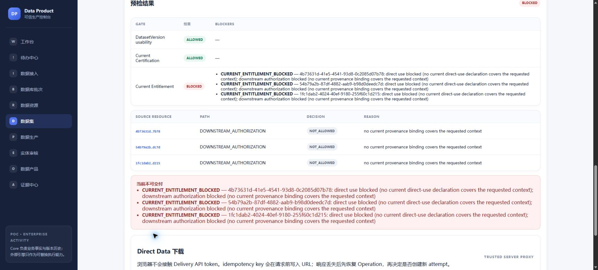

# #299/C3：最终 main 的同源 C1+C2 联验

2026-10-13，有限技术验收 **PASS**。人工解释 **NOT_RUN / 暂缓**。
原合成 Core 的事故继续 **FAIL / NOT_RESTORED**，没有重建或重新播种旧历史。
#298/#299 没有关闭；本轮提交 Draft，不自动合并。

## 精确源码与范围

- 基线：main `c16720abaf986367bade0e91618133e08785e696`（#313）。
- 实际 API SHA256：见 [最终回执](evidence/issue299-c3/final-verification.json)。
  API、Worker、Web、行业规则、迁移和 Core 业务实现均与该 main 一致。
- 新工作区 `codex/issue299-c3`；独立持久卷 run
  `70ca779a-1e21-493b-99b5-445bfaa48275`。Core/source/objects/queue
  启动前后复用 D1 durable-storage admission，拒绝 tmpfs/错卷/嵌套 WAL。
- 当前 Git 全部 63 个迁移文件真实安装，最高 66；顺序 C1/59 → D1/60–64 → C2/65–66。
  Worker 的五个 handler 与 frozen routing 注册通过；两名 Worker 都使用当前二进制。
- 真实 Edge、production Next、PostgreSQL、Hop/JDBC、原生 OpenMetadata 2.0.5。
  原生 PostgreSQL Connector 通过既有 Adapter/Port 接入；不新增 Connector、
  调度器、工单系统、规则引擎或通用基础设施。

## 实际结果

| 场景 | 实际证据 |
| --- | --- |
| B3 同源入口 | 浏览器创建 `e5a1efb1-e0e8-49ff-97a4-d91aca6d6c78`，实际 Hop 抽取、完整 manifest 和三 RAW 原子接纳，6/10/14 行；进入同一用电来源详情及既有实体审核/加工 |
| 最终 RUN 成功链路 | 当前 main 的原生 Connector 实际扫描五列，MATCH；不是旧 catalog 的替代证明 |
| C1 发现与分派 | 原 RAW 真实检测 1/14 负数，case `63f1f2c0-eaca-45ae-87e9-1016eeb4ca47`，绑定原 Finding、规则/hash 和受信任操作者 |
| C1 故障及重试 | 仅停止本轮存储网关，实际处理 FAILED；恢复后显式 retry `c14f852b-f42a-4404-800c-a3fae34ddefc` 成功。基线、失败、成功重试三次 Native 调用各自计费 |
| 新版本与复检 | 新 CURATED `6a4acbb2-3903-46a6-8619-39c605f42206`；14 用电记录 = 13 纳入 + 1 隔离，聚合另计 5 企业行；`-999` 保留，独立 recheck `80717bd6-ec1b-4525-9a58-44b727f53219` PASS |
| 关闭与认证边界 | 关闭后原 RAW 仍 FAIL/REJECTED，新输出仍 NOT_CERTIFIED；之后通过既有 Compliance、证据准备与独立 Certification 得到 CERTIFIED。原 RAW 的 REJECTED 明确含 QUALITY_GATE_NOT_PASSED，另有缺失前提，不冒充质量唯一阻断实验 |
| 实际下载 | 基线及新版本均从浏览器实际下载 640 B，各自 SHA256 与冻结 DatasetVersion 相符。业务指标相同，实际生产时间不同，两个输出 hash 不冒充同一内容 |
| schema 漂移 | 仅本轮合成来源新增全 NULL `schema_probe`；原生扫描 DRIFT，页面展示规则/时间/范围/责任人/差异及 INVESTIGATING 理由；新批次 Prepare 被 AUTHORITY_DENIED 拒绝，仍只有一批次、三 RAW |
| schema 恢复 | 确认 probe 无非空值后恢复批准五列契约；原三张来源表与初始备份逐表指纹完全相等，新原生请求 MATCH |
| 幂等与并发 | C1 retry/recheck/close 各 8 次重放，C2 scan/handling 各 8 次重放，无新增同次事实/调用/成本；复检 409 锁竞争后同 key 恢复原 identity。关闭后新 admission、改同 key 理由及缺失凭据拒绝 |
| 两 Worker | 主 Worker 扫描时次 Worker 实际遇到同来源 advisory-lock 竞争；Outbox 后续恢复，扫描区间不重叠，两份物理 attempt/typed cost。两个成功请求最后均由主 Worker 完成，不声称两个不同成功 owner |
| 真实断连及恢复 | 停止/启动同一 OpenMetadata server，页面 STALE/UNKNOWN 且保留历史；同一 request `c88b8dc5-f858-499f-924c-0e14f639bfda` 保留 7 次 UNAVAILABLE 后 MATCH，8 次真实 invocation 独立计费 |
| 非空发布/投影 | 两份真实 PUBLISHED release，分别绑定独立 ProductVersion；故障发布投影 6 次失败后第 7 次成功，原健康投影 1 次成功；两份发布及旧质量/认证/证据的 exact membership/hash 受保护 |
| 撤权排队 | 暂停确切 C3 Worker、浏览器先接纳请求 `3fdbbc93-1649-4f58-8435-73ae500d3474`、执行既有 RevokeAuthorization，再恢复 Worker：DENIED、0 physical attempt/新增扫描成本 |
| 撤权交付 | 保留旧 ALLOWED 页面后实际提交下载，Core 记录 `7bd1fe89-4715-430b-9c24-118e043e86b6` BLOCKED/CURRENT_ENTITLEMENT_BLOCKED，浏览器无下载；刷新显示 Certification ALLOWED、Entitlement BLOCKED、下载禁用 |
| 撤权重放 | 新/旧成功 scan key 和 handling replay 都 403，零新事实/成本；旧两份 ISSUED、三份认证历史不变，来源保持 REVOKED，没有重新授权 |

独立 C1 oracle **27 checks PASS**，C2 对 17 组历史与全部 prior source observation
membership/content 比较 PASS。共 7 个 source request、13 次物理扫描/13 份 typed cost：
5 MATCH + 1 DRIFT + 7 UNAVAILABLE；DENIED 不包含物理调用。
业务/Audit/Evidence/Outbox 和生产浏览器内容未包含本轮配置密钥。

[最终回执](evidence/issue299-c3/final-verification.json)、
[C1 独立检查](evidence/issue299-c3/c1-final-verified.json)、
[C2 历史与成本](evidence/issue299-c3/c2-final-verified.json)、
[跨 Worker 争锁](evidence/issue299-c3/cross-worker-concurrency.json)。

## 最小修复：新的输出需要新的 ProductVersion

既有 `release-outage` 夹具要求与 `release-healthy` 使用同一不可变输出。
C1 生成新版本后，该命令如实失败，没有生成新发布；原保护正确且保留。
新增有限 `release-repaired-outage`，要求不同的实际 READY/PASS 输出、其明确 C1
recheck association，并复用 CreateVersion/CreateRelease/ValidateRelease/PublishRelease。
它为新输出创建 major 2 ProductVersion，旧 ProductVersion/Release 不覆盖。
没有改动 Core 事实、门禁、迁移或 Worker/Adapter。

在已有的 isolated fixture config 下运行：

```powershell
# 先完成浏览器 C1、复检和独立认证；该 fixture 不生成质量/认证成功事实。
$env:TEST_INGESTION_B3_CONFIG = '<本轮受保护 test.json>'
& .data/pgi-b3-c3-fixture-repaired.exe release-repaired-outage
```

实际两个 ProductVersion/Release 的创建、READY、PUBLISHED 与原生投影重试即为真实
PostgreSQL/Adapter 回归；fixture 编译、go vet 通过。`go test` 对该 cmd 当前显示
`[no test files]`，不将其计为额外断言测试。Draft HEAD CI/评审另行记录。

## 持久化、备份与未完成边界

浏览器前已独立恢复初始全库；最终静止备份再次独立恢复 Core **192 表/1122 行**、
source **3 表/30 行**。原 owner/ACL 和 pgx fresh connections 相符；原生 MinIO
**9 个 version ID/size/payload SHA256** 与恢复副本完全一致，Redis/Hop 归档恢复通过。
OpenMetadata 三个数据库使用原 PG 镜像恢复，角色、DB/function/extension owner/ACL
及真实 SCRAM（错误密码拒绝）通过。源码、二进制、配置、dump 和完整日志只在本地
受保护备份；public evidence 不含这些凭据。

同一 metadata 账户到期后进行等价凭据刷新，identity/authority/duration 与 connector
semantic hash 不变；原有限 Core STS 自然到期，未重新授权或声称凭据永久有效。
首轮和终态恢复副本均保留。原 C1/C2 容器在本轮 preflight 已不在 Docker 清单中；
旧 DPP 卷和备份仍在且未挂载到本轮环境。原丢失 Core 继续 FAIL/NOT_RESTORED。

[完整备份恢复摘要](evidence/issue299-c3/backup-restore.json)、
[原失败命令与证明边界](evidence/issue299-c3/verification-boundaries.json)、
[artifact SHA256](evidence/issue299-c3/artifact-hashes.json)。原 harness 的过强断言/重复
验证容器名称冲突保留为 FAIL；针对声明的 invariants 的独立验证不重标这些命令。

PR #316 首次评审发现公开回执编码/哈希验证 FAIL：Windows 默认 GBK 导出了一条
中文处置理由，Git CRLF→LF 归一化又使 11 份 JSON 的提交字节与工作区哈希不同。
现有 C2 oracle 改为显式 UTF-8/LF 导出，并从保留 Core 只读重新导出；全部字段、
17 组历史和处置理由与原事实完全相同，零业务修改。该证据目录使用 LF Git 属性，
清单按最终字节重算；12 份 JSON 严格 UTF-8 解析和 18 个 artifact 的 Git 内容校验
通过。原始运行、事故和失败命令的结论没有更改。

人工解释、商业 license admission、生产部署、实时来源新鲜度 SLA、全面血缘和通用
调度/告警不在本轮 PASS 范围。只新增本轮有限验收与上述 fixture 命令，不追加总体蓝图。


