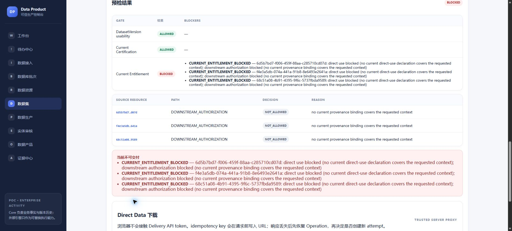

# Issue #299：当前 main 独立技术验收

2026-10-14，Asia/Singapore。本轮六项有限业务技术条件 **PASS**，均有本次实际运行证据；独立环境镜像保留发现的有效缺陷已完成最小修复、真实回归及两份原 OCI 镜像身份恢复。原查询失败回执保留，后续恢复另行追加 **PASS / EXACT_ORIGINAL_OCI_IDS_RESTORED**。修复为 Draft PR #319；其代码 head 的 11 项 CI 已通过，尚无 review submission。**总体验收尚未收口**：非开发者人工解释 **NOT_RUN / 暂缓**，#299 仍 OPEN；原合成 Core `dpp-pgi-b3-core-bc776a791192` 继续 **FAIL / NOT_RESTORED**，本次新库或镜像恢复不证明旧 Core 历史恢复。

本报告复用 AGENTS.md、#299 以及 C1/C2/C3 的有限契约。旧报告用于确定规则和边界，旧实跑、CI 和 Issue 勾选均未计入本次实跑。真实 Edge 操作由 AI 完成，不能替代非开发者人工解释验收。范围为固定合成 PostgreSQL 三表、既有 Hop/Native processing、OpenMetadata 原生 PostgreSQL Connector、Core Commands/Worker/Outbox、质量/权利/认证与 DIRECT_DATA；没有真实客户或政府数据、付费服务、生产部署、provider DELETE 或 cleanup。

开工和业务实跑结束时 remote main 都为 `074a33bace7edbaf481759aac3a84708363ffd02`；Git tree `0b95de3429aa073ba35e311ead5825ddec222f5b`。工作区 `C:/Users/Henry/.codex/worktrees/issue299-independent-20261014/data-product-platform`，分支 `codex/issue299-independent-20261014`，运行 ID `47203cb1-2b93-4946-8f09-72e29022ea4c`。上述 main 实跑阶段的 759 个应用、迁移、行业规则及接入源码文件与该 main 的规范化 Git 字节一致，另存实际工作区字节 SHA256。后来只修复接入验收启动器并新增镜像隔离回归；没有改动 Core、migration、routing、worker 或主 checkout。旧业务实跑身份与新启动器候选身份分开保存。

`#307 / #318` 活跃工作区仅作只读核对；其终态 HEAD 为 `44d5a5390f93a0a464f66e642fea61b5d79846e8`，#318 仍 Draft/OPEN。其 migration 67–68、引用需求/生命周期/Core/routing/原生恢复及保留环境未被占用或修改。本轮源代码仍是 main，不包含该未合并候选。

| #299 技术条件 | 本次结果 | 本次证据 |
| --- | --- | --- |
| 真正发现、分派、处理、复检；失败保留历史 | PASS | 原 RAW 的批准规则真实 Finding 为 1/14；case `19ddf0cb-5948-4111-b95c-82f87fe50ee9` 分派到服务端认证的操作者 `48e6eafb-81c4-4c63-9b62-22962a361f69`。仅停止本轮存储网关，真实 Execution `86b0aae7-4c90-44de-a01e-83d90f88f5e4` FAILED；同网关恢复后显式 retry `e899d077-2cc3-4734-b196-ae23636f9a72` SUCCEEDED，原理由/失败/关联保留。新版本 `77598be5-83c5-43a6-b91f-081b829806ca` 独立 recheck `42e70636-7ce5-45ee-888c-4a15ea3a149d` PASS。 |
| 重放、并发与真实 attempt 成本 | PASS | C1 oracle 27 checks；关闭后的 8 路 same-key retry 恢复同一 Execution，recheck/close 重放不新增事实、调用或成本，改同 key 理由/缺失凭据/外 workspace 拒绝。C2 8 路 scan/handling 重放不新增事实与成本。两 Worker 发生真实 advisory-lock 竞争，Outbox 恢复，两次成功区间不重叠、分别记成本；两次成功均由 secondary Worker 完成，不声称不同成功 owner。 |
| 旧输入、质量、认证保留；新输出独立质量/认证 | PASS | 17 组历史精确 membership/content 比较通过，仅允许既有显式 DatasetVersion SUPERSEDED 且校验其 Event/Audit。原 RAW FAIL/REJECTED 保留。旧输出及新输出分别有真实独立 CERTIFIED；新输出质量 `3e7e3e7a-34b5-4cec-b0ef-a6d10ee3b8b8` 与认证 `6cbd65b0-eede-463c-9a10-43427f35316f`。 |
| 人工关闭不变成质量或认证成功 | PASS | AI 在真实界面执行“仅记录人工关闭”；原 RAW 不翻转。关闭后新输出仍 NOT_CERTIFIED，随后才独立运行 Compliance、冻结实际 Evidence/Effective Rights、执行 Certification。RAW 的 REJECTED 含 QUALITY_GATE_NOT_PASSED，也含其他缺失前提，未冒充质量唯一阻断实验。 |
| schema 漂移、恢复、metadata 失联边界 | PASS | 原生扫描五列 MATCH → 来源实际 ADD 全 NULL `schema_probe` → 原生 DRIFT、界面 INVESTIGATING；新批次 Prepare 实际 AUTHORITY_DENIED，无新增批次/RAW。在源表锁内确认 probe 全为空后恢复契约，新扫描 MATCH，三张来源表与初始备份逐表指纹相同。停止/启动同一 OM server，同请求 `cf309731-3d72-4325-92c3-4684b5be84bf` 的 5 次 UNAVAILABLE 后 MATCH，6 次真实调用分别记账；页面 STALE/UNKNOWN 保留确认绑定，历史 MATCH 不冒充实时来源保证。 |
| 撤权后排队扫描与实际交付阻断 | PASS | 确切本轮 Worker 暂停，Edge 接纳请求 `8f8580ed-a177-4252-8983-662a6e2adc83`，执行既有 RevokeAuthorization，恢复 Worker：DENIED/CURRENT_AUTHORITY_DENIED、attempt=null、0 调用/新增扫描成本。旧 ALLOWED 页面实际下载产生 `f68553ae-d731-4d4a-a055-5819b1402881` BLOCKED/CURRENT_ENTITLEMENT_BLOCKED，0 下载；刷新后 Certification ALLOWED、Entitlement BLOCKED。新扫描/旧成功 key/handling 重放均 403，零新事实/成本。 |

真实 Hop 批次 `0d590729-babb-441d-9494-0eb580a2cca1` 原子接纳 6/10/14 行三份 RAW。新处理同粒度用电 14 = 13 纳入 + 1 隔离，隔离记录保留 `energy_kwh=-999`；5 条企业聚合输出另计，未跨粒度做守恒。新输出从 Edge 真正下载 640 B，SHA256 `06ee909ff45254a351388c9a935fa9d285e26b0d123765531a0a6417c2a3927c` 与冻结 DatasetVersion 一致。保留一个 ISSUED 与后来的 BLOCKED，终态历史没有被回写。

成本结论限定实际业务 attempt：3 次 NATIVE_ENGINE_INVOCATION 各自有一份 CostEvent，包含失败调用，`pricing_mode=POC_ESTIMATE`，不宣称金额为真实账单；4 次 QUALITY_ENGINE_INVOCATION 为 ACTUAL；11 次 SOURCE_SCHEMA_SCAN_INVOCATION 为 ACTUAL、quantity=1/unit=invocation，并一一绑定 typed CostAllocation。另有 3 次真实 Hop invocation 与独立 UNKNOWN intent；UNKNOWN intent quantity=0 不当作实际收费。本报告不将后台治理 GET 的次数、provider 投影重试数或 CI 等同这些扫描/执行成本。

两份非空 PUBLISHED release 为 `109c0d4a-9a2a-40eb-88bc-b399a8bf6eb2` 与 `57ff2ea6-627e-400e-9174-7a48b967b378`，绑定不同 ProductVersion/实际输出。各自有 1 个发布成员、5 个 ancestry DatasetVersion、非空 lineage、3 个 Evidence items；完整 16 组发布事实、成员、祖先、质量/合规/权利及证据 hash 在二次真实断连、恢复和撤权后相同。健康投影 attempt 1 成功；故障发布的真实投影先 FAILED，原 Worker 自动恢复到 attempt 7 SUCCEEDED；原生 DataProduct/domain 与两份投影一致。

本轮迁移实际安装 63 个文件、最高 66，实际时间顺序为 C1/59 → D1/60–64 → C2/65–66。启动和恢复前后的既有 durable-storage admission 校验各角色命名卷，拒绝 tmpfs、错卷、嵌套数据/WAL mount。Worker/Outbox 五个 handler 及 frozen routing 的既有测试与本次运行均通过；二次 Worker 使用与本次 main Worker 完全相同的二进制。

| 独立恢复对象 | 本次结果 |
| --- | --- |
| 浏览器前初始 Core/source | 新卷恢复 PASS：Core 192 表/218 行、source 3 表/30 行，与原备份逐表 SHA256 相同。 |
| 静止终态 Core/source | 另一新卷恢复 PASS：Core 192 表/1096 行、source 3 表/30 行，逐表指纹相同。均为完整 pg_dump -Fc / pg_restore；用于密钥扫描的 data-only 导出不是恢复备份。 |
| Native objects / queue / Hop | 四个停止状态的角色卷以原生 tar 独立恢复，全部文件清单 hash 相同；恢复 MinIO 9 个对象 key/versionId/size/payload SHA256 相同，Redis AOF 能启动并返回 PONG。对象实际 versionId 为 `null`，不声称启用了原生版本控制或生产 WORM。 |
| OpenMetadata | 使用原 PG 15.19 镜像，独立新卷恢复 airflow_db/openmetadata_db/postgres 三库，逐表指纹相同；openmetadata_db 201 表，另两库无业务表。首份恢复副本误判初始化就绪，保留 FAIL；修正后 final2 新副本 PASS。 |
| 原丢失 Core | FAIL / NOT_RESTORED；没有重新启动、重新播种或将上述新库恢复当作旧历史恢复。 |

本地相关 Go 包在独立新命名卷数据库执行 `go test -race -count=1 -p 1 -json`：192 tests PASS，0 FAIL；`TestGXLiveReferenceMatchesNativePassFailSemantics` 和 `TestSourceSchemaNativeReceiptCostRecovery` 因专用配置缺失而 SKIP/NOT_RUN。这些受控 Port + 真实 PostgreSQL 回归单独记录，不冒充本次 Native Provider 实跑。生产 Next build 中 204 command tests 与正式构建通过。没有声称重跑全部 B1/存储故障矩阵、扫描期间 Worker 崩溃矩阵或 #307 处置竞争。

本轮 15 个已知凭据值未出现在完整 Core 业务事实导出及三个正式页面响应中。源码、配置/凭据、完整数据库 dump/globals、对象与队列归档、失败恢复副本及完整技术 trace 保留在受保护本地备份；公开回执不包含这些凭据。

| 二进制 | SHA256 |
| --- | --- |
| API，Go 1.26.5 windows/amd64、CGO=0、trimpath | `2b37123a4358b8e54c0d753d1ece2f7fbf9f185d16cebf8f9dc5ee3d8a19e5cb` |
| Worker | `e25a9c795015b976921ebbd6b26713a4d11b48352365be6c7b7752ae665be733` |
| 既有 bootstrap/publication fixture | `1fc4b84a343f9db937d21e24e3d0f99440413b4908cdd674241b7ace0e52a8fc` |
| Native MinIO | `fb741388b404ec67c4f3777b812d6174ba5562532acb17fb1ddfba9a4e6249b8` |
| 有效 JDBC 42.7.14 jar | `73914527305a40cce504b0d3d90b23caf565136912d607ae8ae7c5895512332c` |

Hop 2.19.0，Java 21.0.12；OpenMetadata 2.0.5。全部 10 个实际容器 image ID/RepoDigest、759 个源码文件的两种字节 hash、2158 个正式 Web 构建文件 hash 见 [identity.json](evidence/issue299-independent-20261014/identity.json)。仓库前端没有 lockfile，本轮保存实际安装依赖树；这些 hash 绑定本次构建，不保证未来 npm 重装得到相同传递依赖。实际镜像与旧试跑的 digest 不同，未用旧镜像报告代替本次身份。

三份 C1/C2/C3 merge push/main CI 已重新核对；当前 main 的 run `38397358035` 也重新确认 `event=push`、`branch=main`、`head_sha=074a33bace7edbaf481759aac3a84708363ffd02`、11/11 SUCCESS。CI 是代码基线证据，未替代本次浏览器、原生 Provider 或备份恢复结果。

本轮验收适配、失败调用及根因见 [failure-ledger.json](evidence/issue299-independent-20261014/failure-ledger.json)。旧发布 oracle 不适合直接使用修复后输出的 fixture label，本轮只适配实际 `release-repaired-outage` 标签，所有非空、完整 membership/hash、当前 gate、阶段和原生 Provider 断言保留，源码 hash 见 [closure-oracle-binding.json](evidence/issue299-independent-20261014/closure-oracle-binding.json)。旧 FAIL、自动审查拒绝、CLI/截图失败没有重标 PASS。

最后的保留检查发现 `smoke.py` 与 `prepare_binary()` 重建共享 Hop/MinIO 标签；这是复用启动器前的预检遗漏。旧 C3 容器仍引用 `401553bc…` / `8c712a2f…`，Docker 却已无法查询这些原镜像对象。旧容器、卷、对象和数据库没有被删除、启动或重新播种，但不能声称原镜像身份仍完整保留。已只读导出两份旧容器 rootfs 到受保护备份，SHA256 和限制见 [old-image-retention-defect.json](evidence/issue299-independent-20261014/old-image-retention-defect.json)；导出 rootfs 不是原 OCI 镜像恢复，不覆盖 FAIL。

继续恢复时，Docker 原构建记录 `jz6yudwfhfayrfa21eg88wwco` / `mi4g4leqqgsnz4ze4qwk9jp9o` 仍保留两份原 index、manifest、config、完整 provenance 与 layer。通过 [Docker 原生 build history export / attachment](https://docs.docker.com/reference/cli/docker/buildx/history/inspect/attachment/) 读取原字节；两个最小 provenance statement 从原完整 predicate 按 [BuildKit v0.33.1 的 min 规则](https://github.com/moby/buildkit/blob/v0.33.1/solver/llbsolver/provenance.go)还原，其 SHA256 分别严格等于原 attestation manifest 中的 `ff1bd72c…` / `931486dc…`，没有替换时间、主体、版本或 digest。Hop 14 个、MinIO 9 个 descriptor（含共享空配置）全部验证原 size/SHA256 后封装标准 OCI archive，使用 Docker 原生 load/tag 恢复；原 ID `401553bcfe449470f33e8efb5ce4414dec4e880eec357b37738d41d0c2b6df18` / `8c712a2fe14b096ebb65f17c976a3aff15857ca1ad63a0cef250fdc22771202b` 均能直接查询。不是重新 build 或 container commit 得到的新身份。随后原生 image save 并逐 blob 独立核对完整备份；恢复详情与 helper 源码见 [old-image-recovery.json](evidence/issue299-independent-20261014/old-image-recovery.json)。首次 helper 的短 ref-name 导入后无法由规范化 tag 查询，该失败步骤保留；原 ID 已可查询，后续使用原生 canonical tagging 完成。两份旧容器 Id/Image/State/Mounts 与共享标签前后完全相同；没有启动旧服务或挂载旧数据。

最小修复使用 Docker 原生能力：每轮唯一 trial 标签，build 后解析 immutable image ID，B1/B2/B3/存储试跑的容器均按 ID 创建，避免构建覆盖共享别名或后续容器读取变化的标签。所有已知调用方同步更新，没有兼容 shim、新组件、Core/门禁或 SDK 修改。修复文件与 #307 活跃写域不重叠。另一个新命名卷运行 `857d0db9-8326-4ee1-8f94-f8c06bbeaf25` 的真实 Docker 回归通过 5 项：两次 MinIO build 后前一镜像仍可查询；容器配置固定 image ID；Hop 使用独立 tag/ID；真实 6/10/14 抽取 PGI-01/02 的原值、编码与重复字节 hash 通过；共享别名前后相同。该回归没有创建 Core 业务事实或 cleanup，未冒充补跑完整 C1/C2。候选源码 hash 见 [image-isolation-regression.json](evidence/issue299-independent-20261014/image-isolation-regression.json)。修复提交 Draft，不自动 Ready 或 merge。

Draft 修复代码 head `d9cecc187e2d51609a208dafcde232495cc0d6c2` 的 run `38554333469` 为 `event=pull_request`、11/11 SUCCESS，见 [draft-pr319-ci-d9cecc1.json](evidence/issue299-independent-20261014/draft-pr319-ci-d9cecc1.json)。后续恢复只追加报告和证据，五份修复源码字节不变；PR CI 不冒充 merge/main CI。尚无 review submission，不把作者核对或 CI 当作独立批准。保留应用在 Edge 刷新后仍显示 DatasetVersion/Certification ALLOWED、Current Entitlement BLOCKED、下载禁用；来源保持 REVOKED。

当前环境观察另见 [metadata-session-expiry.json](evidence/issue299-independent-20261014/metadata-session-expiry.json)：本轮 metadata JWT 到期，原生治理读取返回 401，来源页面按现有规则显示 UNKNOWN；最近请求仍为 DENIED / CURRENT_AUTHORITY_DENIED。该读取没有请求 Connector 扫描，没有续期来源授权或改变历史事实；过去 11 次物理扫描与当前 availability 分开记录。

必须继续完成项为 Draft 修复评审、非开发者人工解释验收；原 Core 丢失事件仍未恢复，#298/#299 未关闭。生产 IAM、商业 license/provider admission、真实客户数据、实时来源新鲜度 SLA、完整血缘及生产灾备不属于本轮业务技术 PASS。

关键回执：[C1 27 checks](evidence/issue299-independent-20261014/c1-final.json)、[C2 历史与成本](evidence/issue299-independent-20261014/c2-final.json)、[撤权/密钥/源恢复](evidence/issue299-independent-20261014/final-checks.json)、[发布保护](evidence/issue299-independent-20261014/publication-post-revocation.json)、[终态 Core 恢复](evidence/issue299-independent-20261014/backup-final.json)、[对象/队列/Hop 恢复](evidence/issue299-independent-20261014/volumes-backup-final.json)、[metadata 恢复](evidence/issue299-independent-20261014/metadata-backup-final2.json)、[原 OCI 镜像恢复](evidence/issue299-independent-20261014/old-image-recovery.json)、[artifact SHA256](evidence/issue299-independent-20261014/artifact-hashes.json)。应用入口 `http://127.0.0.1:56117`；当前来源保持 REVOKED。本线程未执行 provider DELETE、容器/卷/对象/备份 cleanup；本轮原始、恢复、失败副本和回归资源保留，旧镜像查询 FAIL 与后续 exact-ID 恢复 PASS 分别保存。

