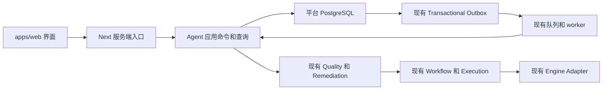

# Agent 质量闭环后端契约设计

状态：Q1 只读查询与 Q2 委托、冻结计划、人工确认和动作意图持久化已在本地隔离分支实现。Q2 不派发动作；Q3/Q4 的 owner 执行、重试和成果报告仍为设计提案，尚未实现。日期：2026-10-24。Q2 的实际实现与验收见 [实施记录](../product/agent-quality-q2-implementation.md)。验证结果见 [Q1 实施记录](../product/agent-quality-q1-implementation.md) 和 [真实 Core 只读联调](../product/agent-quality-q1-live-readonly-acceptance.md)。

本契约定义首期确定性质量 Agent 的应用边界。平台保存委托、冻结计划、人工确认和动作收据；实际评测、修复执行、版本、成本与业务门禁仍由现有领域拥有。产品范围与工作包见 [首期接入方案](../product/agent-quality-backend-pilot-v1.md)。

## 权威边界

| 事实 | 唯一业务 owner | Agent 可保存的内容 |
|---|---|---|
| 委托、计划修订、人工确认、成果审阅 | 拟新增 Agent 应用能力，平台 PostgreSQL | 自有事实，追加历史 |
| 原始/成果版本与血缘 | Dataset、既有生产 owner | 精确 ID、hash 与证据引用 |
| 检测、finding、质量结论、物理评测尝试 | Quality | assessment/attempt 引用与观察时间 |
| 处置案例、认领、执行关联、复检关联、手工关闭 | Quality Remediation | case/link/recheck 引用，不能另存一套 case 状态机 |
| 真实执行、重试关系与引擎状态 | Workflow/Execution 及其恢复能力 | execution 引用与 owner 原始状态 |
| 实际调用成本 | 现有 CostEvent/CostAllocation owner | 关联业务对象查询，不再按 Agent 步骤记第二次调用成本 |
| 认证、权利、发布与交付 | 各既有领域 | 授权导航与只读展示，无自动通过或修改 |

拟采用的调用结构：



Agent 调用应用服务适配器，不由浏览器直连数据库、对象存储或引擎。部署仍使用现有服务，不建立独立 Agent 微服务或新队列。

## 已有接口和限制

下列路径来自当前代码。后续实现以代码与既有领域契约为准，不把本节视为新增 API。

| 操作 | 已有接口 | 关键契约 |
|---|---|---|
| 版本列表 | `GET /api/v1/workspaces/{workspaceId}/datasets/{datasetId}/versions` | readmodel 查询，Agent 入口还需统一可信身份与对象归属检查 |
| 明确版本 | `GET /api/v1/dataset-versions/{versionId}` | workspace 与 Dataset 关联校验；Agent 不因 ID 有效就信任其归属 |
| 独立质量检查 | `POST /api/v1/dataset-versions/{versionId}/quality-checks` | body 含 workspaceId、ruleSetRef、engineName、assessmentAttemptId；不允许匿名降级 |
| 历史、精确报告、尝试 | `GET /api/v1/dataset-versions/{versionId}/quality-assessments`；`GET /api/v1/quality-assessments/{assessmentId}/report`；`GET /api/v1/quality-assessment-attempts/{attemptId}` | 质量查询需要 workspaceId；精确选择不回退 latest |
| 异常检测 | `POST /api/v1/workspaces/{workspaceId}/quality-remediations/detect` | body 为 versionId，Idempotency-Key；只支持该已配置模板适用的 RAW |
| 案例查询 | `GET /api/v1/workspaces/{workspaceId}/quality-remediations/{caseId}` | 只读投影，含原 finding、认领、执行关联、复检与关闭事实 |
| 认领 | `POST .../quality-remediations/{caseId}/assign` | reason；认领人是当前可信 actor，没有任意成员选择参数 |
| 修复 | `POST .../quality-remediations/{caseId}/execute` | reason、workflowVersionId、outputDatasetId、targetPeriod、具名 inputs；均由冻结计划带入 |
| 业务重试 | `POST .../quality-remediations/{caseId}/retry` | reason；仅对最新 FAILED/CANCELLED 执行显式重试，由 owner 创建新的 Execution |
| 独立复检 | `POST .../quality-remediations/{caseId}/recheck` | executionLinkId，不是 executionId；Quality attempt 与实际输出由领域关联 |
| 手工关闭 | `POST .../quality-remediations/{caseId}/close` | reason；不改变质量或认证结论，也不是 Agent 成果审阅 |

现有修复服务仅在配置了 `QUALITY_REMEDIATION_PLAN_REF` 后装配；接口存在不等于已启用。受控模板 `industry-packs/park/remediation/energy-quarantine-v1.yaml` 固定诊断与复检规则、workflow 定义 hash、输出 Dataset code。`LoadPlan` 当前要求三 RAW + 一 STANDARDIZED；`validateInputs` 从已接纳 receipt 验证同批三输入及指定来源的真实实体解析输出。首期使用这个切片，不扩大为任意单版本修复。

`Detect` 返回 `caseId = null` 只说明没有登记本模板可处理的异常。必须再检查明确 assessment 的 gate/findings；不能把无 case 显示成“质量全部通过”。原型的 `STD-0001`、`PLAN-0001`、`USR-01` 不能当作真实规则、workflow 或 actor ID。

## 拟新增对象

以下是逻辑存储设计，尚无迁移和 API。字段名可在实现时统一风格，语义不可省略。核心引用、状态、规则/hash、确认范围与幂等身份使用强类型列/关系；JSONB 只容纳展示说明或受控扩展。

| 对象 | 强类型字段与含义 | 历史规则 |
|---|---|---|
| AgentTask | id、workspaceId、kind=QUALITY_DIAGNOSIS、createdBy、parentTaskId、currentPlanRevisionId、revision、controlState | controlState 是 ACTIVE/PAUSED/STOPPED 当前投影；修改需显式命令和 parent row lock |
| AgentPlanRevision | id、taskId、ordinal、phase、sourceVersionId、sourceAssessmentId、findingId、caseId、templateRef/version/hash、detectionRuleRef/hash、workflowVersionId/hash、outputDatasetId、targetPeriod、recheckRuleRef/hash、goal、purposeNote、acceptanceText、contentHash | 创建修订后冻结；诊断阶段不要求存在全部修复绑定，修复阶段必须建立完整新修订 |
| AgentPlanInput | planRevisionId、inputName、datasetVersionId、required、receiptId 或 resolutionJobId 的强类型关联 | required input 精确集合参与 hash；行业输入名来自模板，不硬编码行业分支 |
| AgentPlanAction | planRevisionId、ordinal、commandKind、approvalPhase | 允许动作白名单；不从自然语言或任意 JSON 解析出待执行命令 |
| AgentApproval | id、taskId、planRevisionId/hash、phase、actorId、subject、scopeHash、retryOfActionId、reason、createdAt | append-only；诊断确认、修复确认、新实际重试确认分别记录 |
| AgentActionRequest | id、workspaceId、taskId、planRevisionId、approvalId、commandKind、ordinal、requestKey、fingerprint、businessRequestKey、retryOfActionId、dispatchState | 意图和业务键冻结；dispatchState 仅表示受理/派发投影，不替代 Execution/Quality 状态 |
| AgentActionObservation | actionId、ordinal、observedAt、observationKind、safeErrorCode，以及 detectionId/caseId/executionLinkId/executionId/qualityAttemptId/assessmentId 等合法强类型引用 | append-only；不同 command 限定合法引用组合，关联对象必须同空间且相互一致 |
| AgentReport | id、taskId、planRevisionId、sourceVersionId、outputVersionId、原评测/复检 ID、caseId、executionLinkId、checks、createdAt、contentHash | 固定证据与其成员；checks 的可查询判定使用强类型，不把 gate 藏入任意 JSON |
| AgentReportReference | reportId、referenceKind、强类型目标关系 | 精确计划、确认、动作与证据成员；禁止仅保留字符串 URL 冒充业务关系 |
| AgentReportReview | id、reportId、actorId、decision=ACCEPT/RETURN、reason、createdAt | append-only；退回产生关联新任务，不能修改原报告结论 |

`purposeNote` 是委托用途说明，不产生使用权或授予权。业务方案不等同 WorkflowVersion；本期仅拥有有限的 Agent 操作计划，不实现 UseCase/需求管理模型。

### 原子冻结和锁顺序

所有修改先锁 AgentTask，再依序锁当前计划/动作；调用下游业务服务不跨事务持有这些行锁。计划创建命令在同一事务内插入 header、具名 inputs/actions、验证完整成员并计算 hash，再冻结并更新 task 的 currentPlanRevisionId。成员写入与冻结共享 parent lock；冻结后 INSERT/UPDATE/DELETE 均拒绝。

contentHash 使用 UTF-8 规范化对象的 SHA-256：具名 inputs 按 inputName 排序、动作按 ordinal 排序，固定版本 1 的字段 envelope 包含上表所有业务范围、规则/hash 和确认文本，排除时间与易变展示状态。复用仓库已有 JCS 依赖和 hash 经验，不编写另一套 JSON canonicalizer；最终 canonical envelope 与正反例纳入 Q2 契约测试。approval 同时绑定 revisionId 与 hash，不只比较文本摘要。

报告采用相同的 parent-first 规则冻结 header 与 references。不能只在冻结后加 trigger，却允许旧事务在冻结后补交成员。审批和审阅直接以不可变单行事实追加；不通过软删除或覆盖修正历史。

修订、确认、暂停、停止和动作受理竞争同一个 task lock/revision。相同序号/幂等键的唯一约束只作兜底，不能替代锁内状态、完整内容和归属检查。

## 拟新增命令和 API

统一前缀 `A = /api/v1/workspaces/{workspaceId}/agent-tasks`。本节全为拟新增，不能当作已有可调用接口。实现优先复用现有 Go application、transaction、repository 与 HTTP 风格。

| 方法与路径 | 应用命令或查询 | 请求关键字段 |
|---|---|---|
| `GET /api/v1/workspaces/{workspaceId}/agent-quality-context?versionId=...` | GetAgentQualityContext | 精确版本；返回对象、已配置模板、缺口、服务器允许动作与各子查询 known/unknown |
| `POST A` | CreateQualityAgentTask | sourceVersionId、goal、acceptanceText、可选 parentTaskId；服务器构造初始诊断计划 |
| `GET A` / `GET A/{taskId}` | ListAgentTasks / GetAgentTask | 分页、状态过滤；详情包含明确记录和 revision，禁止跨任务全局选择回退 |
| `POST A/{taskId}/plan-revisions` | ReviseAgentPlan | expectedTaskRevision、basePlanRevisionId；模板和业务绑定由服务器重新准备/验证 |
| `POST A/{taskId}/approvals` | ApproveAgentPlan | expectedTaskRevision、planRevisionId、contentHash、phase、reason；重试确认须绑定 retryOfActionId |
| `POST A/{taskId}/actions` | RequestAgentAction | expectedTaskRevision、planRevisionId、approvalId、commandKind、reason；实际参数从冻结计划取得 |
| `GET A/{taskId}/actions/{actionId}` | GetAgentAction | 原意图、收据、owner 状态与观察；不触发新实际工作 |
| `POST A/{taskId}/actions/{actionId}/reconcile` | ReconcileAgentAction | expectedTaskRevision；追加现有业务事实观察，不接受“成功/失败”的人工填值 |
| `POST A/{taskId}/pause`、`/resume`、`/stop` | PauseAgentTask / ResumeAgentTask / StopAgentTask | expectedTaskRevision、reason；不改写下游引擎状态 |
| `POST A/{taskId}/reports` | PrepareAgentReport | expectedTaskRevision、planRevisionId；服务端读取明确业务引用后冻结报告 |
| `GET A/{taskId}/reports/{reportId}`、`/export` | GetAgentReport / ExportAgentReport | 按精确报告再次鉴权；不以列表最新项替代 |
| `POST A/{taskId}/reports/{reportId}/reviews` | ReviewAgentReport | expectedTaskRevision、decision、reason；每份报告一个有效最终审阅，重复请求返回原结果 |

动作白名单首期只含 `DETECT`、`ASSIGN_SELF`、`EXECUTE_REPAIR`、`RETRY_REPAIR`、`RECHECK`。没有模型工具名、SQL、脚本、任意 API URL、任意输出 URI 或 `PATCH status`。当期阶段、owner 已有结果、controlState 和确认共同决定动作是否可受理。

新命令要求 `Idempotency-Key`；键作用域包含 workspace、命令与目标对象。相同键且相同规范化请求返回原结果；同键不同 fingerprint 返回 409，不能静默采用新输入。`expectedTaskRevision` 只用于首次受理前置判断；完成鉴权/归属检查后，合法 same-key replay 先返回原已受理事实，不因其自身已增加 revision 而虚构冲突，也不会重新执行动作。

示例是拟新增协议，不使用真实业务 ID：

```json
{
  "expectedTaskRevision": 4,
  "planRevisionId": "<uuid>",
  "approvalId": "<uuid>",
  "commandKind": "EXECUTE_REPAIR",
  "reason": "已核对本批次输入、隔离策略及目标成果"
}
```

服务器从 revision 取出 workflowVersionId/hash、全部 input bindings、outputDatasetId、期间、模板与规则 hash。不得信任客户端重传的更宽参数。

### 需要补齐的既有领域查询

Detect 的现有内部检测登记先于 Quality 调用，但没有公开的按 requestKey 恢复查询；无 case 时也不能依靠 case 列表找回结果。拟为现有 Remediation owner 增加 scoped `LookupDetectionByRequestKey` 查询，返回 detectionId、原质量 attempt、是否存在 case、已知结论或 in-progress/unknown。它不再次调用引擎。

Execute/Assign 的现有 case detail 未把所有 command requestKey 都作为稳定查询字段暴露。拟补 scoped `LookupRemediationCommandReceipt(caseId, commandKind, requestKey)`，从现有不可变关系查询 assignment/executionLink/recheck ID；不复制一套执行账本，不要求前端访问 SQL。

这些查询可作为 Agent 应用内部 Port；若以后单独暴露 HTTP，仍须使用相同 principal、workspace 和安全错误处理。现有 case detail 的 case/assignment 使用数据库列名，部分子项使用 camelCase；适配层按当前固定形状逐字段建类型并验证 UUID 关系，不为同字段提供两套拼写兼容。不能靠 TypeScript 断言声称响应有效。该查询还包含执行的 errorMessage，Agent 响应必须做字段白名单和安全错误码映射，不能原样透传引擎错误。

## 身份和数据边界

首期是单受信办理人的受控试点。复用现有 `principal.Resolver` 与 `HUMAN_DECISION` 能力，在 Agent 所有 GET/POST/export 入口验证当前授权工作空间；查询实际关联的 Dataset/版本/评测/案例/执行归属，不只验证请求字段格式。合法 workspace 下的其他对象按 404 处理，未配置或无凭据按 401，越权按 403；保持既有领域端点错误语义，不由前端放宽。

Next 服务端保管已有配置来源的服务凭据，不送浏览器、URL、报告、日志、outbox 或任务参数。浏览器传 actorId、consumer、角色或演示成员 ID 都不能建立身份。队列 payload 仅携带 actionId；worker 从受信配置重新解析当前主体及 workspace/capability，不把存档 actor 或旧确认当作永久授权。

worker 的当前 subject/actor 必须与该批准动作的主体绑定一致；配置换人或身份不可确认时阻断，不能自动改用另一个 actor 续办并覆盖原操作者。首期使用既有受控身份来源；未来接可撤销的用户身份时，需单独明确其当前有效性与并发撤销契约，不能据此声称本期已经具备多用户 SSO。

如果凭据对应固定服务 actor，UI 必须表明“受控办理人”，不能把不同访客操作记成其真实个人行为。正式多人开放需先接现有/标准身份体系与可信 principal 映射；本期不自建密码、Token 或 RBAC 引擎，也不把未认证的公开 Web 页面接到可写服务凭据上。

Agent 上下文限定元数据、必要 finding 和有权限的证据，首期不提供原始数据下载。新增上下文查询使用授权后的 scoped repository，不借 generic read 路由绕过证据鉴权。模板路径由服务器配置白名单解析，未知模板/hash 不进入执行。

## 审批和业务条件

| 确认阶段 | 必须固定的内容 | 能批准的动作 |
|---|---|---|
| DIAGNOSIS | sourceVersion、诊断规则/hash、模板/hash、目标与验收说明 | 一次明确的检测动作，不含修复 |
| REPAIR | 原 assessment/finding/case、完整 input 集合与 receipt/解析依据、workflowVersion/hash、固定输出 Dataset、期间、复检规则/hash | 按顺序认领、一次修复及其输出复检 |
| RETRY | 上述 REPAIR 范围，以及明确失败的 prior action/execution | 一次新的实际业务重试及该次输出的复检；复检仍有独立请求身份 |

新修订不改变旧确认；旧确认仅可解释其原 revision。一个确认不得被并发消费成两个相同阶段的实际动作。计划修订/新确认前检查是否存在未决派发，未决时先恢复原请求；不能换 revision 掩盖它。

受理在锁内按 approvalId 与计划动作槽位建立唯一关系；同槽位不同请求键也不能重复实际工作。新的实际 RETRY 必须有新确认与新槽位，强类型关联上次失败动作；复检只绑定这一槽位执行产生的 executionLink，不能借原确认评测其他输出。观察按 action 与 owner 事实身份/规范化状态摘要去重，摘要排除观察时间；重复轮询相同事实不反复追加成功或成本事件。

修复绑定从服务端 receipt 与实体解析事实准备。任一 required input 缺失、不在该 receipt、解析来源不匹配、输出 Dataset 与模板不符、workflow hash 不匹配、案例已手工关闭，均阻断。后端当前配置模板 hash 变化时，不自动升级旧 case 或旧确认；保持已有领域拒绝规则，发起新委托/新检测并重新确认，直到相应历史模板执行能力被单独设计。

初始计划只固定诊断范围，检测产生的 assessment/case 通过新修复修订纳入，不回写原计划。无 case 且 assessment gate=PASS 时可形成无需修复报告；PASS_WITH_WARNING、REVIEW、FAIL 或不支持的 finding 必须如实展示，本期不能自动开放“修复已完成”的接受动作。

## 受理和恢复协议

### 两个事务域

`transaction.Manager.Do` 当前每次开启新事务，不能假设在外层包一个事务就把 Agent 与既有 Remediation 服务原子化；Quality/引擎也不与 PostgreSQL 同事务。采用已有 outbox/queue 的 durable command intent，而非在前端顺序调用多个接口。

1. **受理事务**：锁 task，验证 revision、当前 principal、计划/确认与阶段；插入不可变 action intent、稳定 businessRequestKey、审计/证据和 `AgentActionRequested` outbox。此时只证明请求已保存，页面显示待受理。
2. **派发事务**：现有 worker 获取任务后锁同一 task/action，确认未暂停/停止、修订仍匹配且当前主体有效；追加 `DISPATCHED` 决定再提交。这是该动作开始受理的线性化点；同 action 的重复消息不创建第二次开始决定。
3. **领域调用**：提交事务后，用冻结请求与稳定 businessRequestKey 调用现有 Command。执行引擎仍由领域既有队列启动；Agent worker 不直接访问 engine。
4. **收据事务**：追加带精确 owner ID 的 observation 及事件/审计/证据。成功受理 Execution 只能显示已排队/运行，不显示已成功；实际终态通过 owner 查询获得。
5. **恢复**：重启或响应丢失后，优先从稳定业务键查 owner 收据；可恢复 same-key 请求时仍是原 action/request，不能换键。恢复必须重新检查当前主体与领域访问规则；无法确认时保持未知并阻断新工作。

队列按至少一次投递设计，不承诺全链路 exactly-once。避免重复效果依赖 action 受理幂等、领域原请求幂等、唯一关联及既有 Execution/Quality 尝试约束。新增 handler 应注册到现有 outbox 的路由版本与所需消费者集合，未消费的事件不可直接标记完成。

### 崩溃和超时矩阵

| 中断位置 | 下一次恢复 | 禁止行为 |
|---|---|---|
| action/outbox 提交前 | 同一请求键返回未受理或重新原子受理 | 把浏览器开始等待当作已执行 |
| action/outbox 提交后，派发前 | 现有 outbox 重投；同 action 判断当前 controlState | 为重投生成新 action 或业务键 |
| DISPATCHED 后，领域调用前 | 查询原业务键；仅按领域允许的 same-key 规则恢复原请求 | 直接判失败后产生新实际重试 |
| 领域提交后，Agent 收据提交前 | 查原检测/认领/执行/复检关联并追加收据 | 再运行一次来填补页面结果 |
| worker/HTTP 超时，owner 仍运行 | 展示 owner 的 IN_PROGRESS/QUEUED/SUBMITTING/RUNNING 或读未知 | 提供“人工指定成功”或新执行按钮 |
| 原 owner 已明确失败 | 用户确认 RETRY 范围，提交新 action 与新业务请求 | 用旧顶层 task key 吞掉新工作及成本 |
| 报告或审阅提交后响应丢失 | 同 key 返回同一冻结报告/审阅 | 修改原报告或再记一次接受 |

对于内部请求传输重放，Agent 不另记 engine 调用成本；对于真正的新业务尝试，继续由 Execution/Quality owner 记录新增 CostEvent 与关联。当前未决业务尝试与单纯 GET 读取未知需分开：后者不会把已知业务终态改为未知。

## 暂停 停止和外部人工办理

Pause 与 worker 的 DISPATCHED 判定竞争同一 task lock。Pause 先提交，后续待派发动作不能执行；DISPATCHED 先提交，则 UI 明示该动作已受理、可能继续完成，Pause 仅阻止下一动作。后台读取和收据恢复仍继续。

Stop 只允许没有未决 DISPATCHED 动作时执行，取消尚未受理的 Agent 意图并记录停止原因。存在未决动作返回 `409 ACTION_UNRESOLVED`，可以暂停与核实原运行。Resume 重新检查当前确认、模板、主体与依赖；不会自动新建业务运行。没有公开的可信引擎取消命令时，禁止把停止委托渲染成运行已取消。

既有人工质量页面保持原命令路径与领域规则。Agent 审批只限制 Agent 自己的代理动作，不声称所有人工操作都经过它。若他处核实或完成了同一个明确 action 关联的业务请求，Agent 追加观察即可；其他人工请求或相邻版本不自动吸收为本委托成功。当前 case 已关闭或办理人变化后，新的 Agent 业务动作应按领域规则阻断。

首期 UI 的“执行中、阻断、待核实、待审阅”等为多事实投影：同时返回 controlState、owner 原始状态、各查询的 knowledge 和 allowedActions。不能靠单个 task.status 改写领域事实，也不能把页面加载失败当作业务失败。

## 报告 审阅和关联新委托

报告固定当前计划、输入与输出、原评测与具体复检、确认记录、动作意图、owner 收据、Audit/Evidence 引用。表述区分已知事实、未验证原因和建议。正文可以有安全的渲染快照，但关键成员必须有强类型关联与内容 hash。

修复报告进入可接受状态至少要求：正确源与完整冻结输入；已批准的确切 workflow/输出绑定；所引用 Execution 成功；其唯一实际输出对应的精确独立复检为 PASS；关键引用完整且可验证。无修复分支则要求确切诊断 PASS 且未发现本模板需处理异常。不能由 case.closed、某个 latest assessment 或客户端分数推断。

PrepareAgentReport 不自动调用 case.close、认证、发布、交付或业务验收。人工 ACCEPT/RETURN 均需可信 actor 与说明；提交时重新检查待审阅报告身份、当前审阅状态和必要验收事实，单报告最终审阅唯一。后续权利、认证或版本失效不改写历史报告接受事实，页面另显示当前业务资格；接受不提供任何交付授权。

RETURN 保留原报告和原成果；新建 AgentTask 时强类型 parentTaskId 引用原任务，新计划重新确认。若修复模板不能在原已关闭 case 上继续，只能按既有规则新检测/新 case；缺少条件时继续阻断。本期此行为不创建真实新需求，不恢复原 case，不复制其当前 entitlement。

报告导出与详情使用同一鉴权和精确成员查询，包含 workspace、各固定 ID、批准范围、原始尝试与核实、审阅记录、剩余治理事项；无服务凭据、引擎原始错误体或可用下载 secret。

## 错误和查询契约

拟新增 Agent 错误码：`STALE_TASK_REVISION`、`PLAN_APPROVAL_REQUIRED`、`PLAN_BINDING_CHANGED`、`INPUT_BINDING_INCOMPLETE`、`ACTION_UNRESOLVED`、`IDEMPOTENCY_CONFLICT`、`REPORT_NOT_READY`、`TASK_STOPPED`。所有错误带 requestId 与安全的 blockers，不返回 provider 原始响应。上述代码尚未实现，不能替代既有领域错误码。

查询子区块分别具有 KNOWN/UNKNOWN 与引用 identity：源版本、输入集合、历史列表、明确报告、运行观察互不替代。已知空集合必须有成功查询依据；超时和拒绝不是零。读取明确历史报告失败时保留其 ID 与未知状态，不读取相邻或最新报告冒充。新操作在相关必要依赖 UNKNOWN 时拒绝受理；无关区块未知不抹去已知事实。

## 复用与自建边界

| 能力 | 决定 | 原因 |
|---|---|---|
| 实际处理与质量规则 | 复用现有 native/industry-pack、Engine Port 与 Remediation | 当前支持的切片有明确领域语义与冻结依赖 |
| 任务派发与恢复 | 复用已有 Asynq、worker、Outbox、领域 reconciliation；只加有限 command adapter | 不新增通用 durable workflow runtime；能力地图中的 Temporal 候选不构成本期引入理由 |
| 事务与持久化 | 复用 PostgreSQL、transaction manager、Audit/Evidence/Cost | 新增的是平台委托与确认事实，不是第二套基础设施 |
| 登录与授权 | 复用现有 principal 的受控试点；多人阶段单独接标准身份方案 | 不新建密码/Token 服务或 policy engine |
| 元数据/规则目录 | 现有查询与已配置模板描述 | 不复制 OpenMetadata 产品能力，不建通用模板市场 |
| Agent 运行时/模型 SDK | 本期不引入 | 固定动作模板与人工确认足以验证真实后端闭环 |

新增业务对象只负责本平台的确认范围、动作关联与成果审阅，这是当前仓库尚缺的产品语义。没有新增 OSS、license 或部署组件；若未来增加通用运行时、模型服务或其他基础设施，应另做 AGENTS 要求的 Build-vs-Buy/Reuse Check。

## 有限评审和测试边界

本提案的实现阻断项限于：可信身份/空间绕过、确认与真实输入不一致、幂等或并发破坏历史与实际调用、原请求不可恢复、错误输出/复检引用、凭据泄漏，以及该切片必需路径测试失败。模型能力、完整 IAM、跨行业自由编排、通用 Workflow UI 和全量白皮书覆盖转后续。

必须使用真实 PostgreSQL 检查计划/报告冻结与 late membership、同 key 并发、修订/暂停/停止/派发竞争；做 crash-after-business-commit 的恢复用例。领域与应用测试覆盖所有合法/非法动作，HTTP 覆盖身份/空间/对象/历史错误；浏览器验收使用隔离合成批次和真实 Core 查询/命令。完整用例与完成标准以产品文档 A01–A12 为准。

## 当前代码依据

核对基线：本地 `main`，HEAD `f7a90022aad5da4d67ea594ccb86f8b9925a3840`。本轮未启动服务或验证部署状态。以下是复用事实的源码入口；旧验收文档只解释原切片，不作为本提案已运行的证据。

- [Quality API](../../apps/platform/internal/quality/transport/http/handler.go)、[质量授权](../../apps/platform/internal/quality/transport/http/authority.go)。
- [Remediation API](../../apps/platform/internal/quality/remediation/transport/http/handler.go)、[命令服务](../../apps/platform/internal/quality/remediation/application/service.go)、[模板约束](../../apps/platform/internal/quality/remediation/application/plan.go)。
- [案例关联存储](../../migrations/000059_quality_remediation.up.sql)、[精确案例查询](../../apps/platform/internal/quality/remediation/infrastructure/repository.go)。
- [配置模板](../../industry-packs/park/remediation/energy-quarantine-v1.yaml)、[处理定义](../../examples/enterprise-activity/workflow/workflow-v1.yaml)。
- [principal](../../apps/platform/internal/platform/principal/principal.go)、[transaction manager](../../apps/platform/internal/platform/transaction/manager.go)、[既有 queue](../../apps/platform/internal/platform/queue/asynq.go)、[outbox 路由](../../apps/platform/internal/platform/outbox/router.go)。
- [Web Quality Command](../../apps/web/lib/quality-command.ts)、[Web Quality transport](../../apps/web/lib/quality-transport.ts)、[Web 现有处置 actions](../../apps/web/app/datasets/[id]/versions/[versionId]/remediation/actions.ts)。
- [既有 JCS 使用入口](../../apps/platform/internal/sourceadmission/manifest.go)、[证据 hash 入口](../../apps/platform/internal/evidence/hash.go)。
- [质量证据授权说明](../acceptance/issue361-quality-authority.md)、[原生执行恢复契约](native-execution-recovery-and-output-idempotency.md)、[Outbox 幂等契约](outbox-delivery-and-idempotency.md)。
