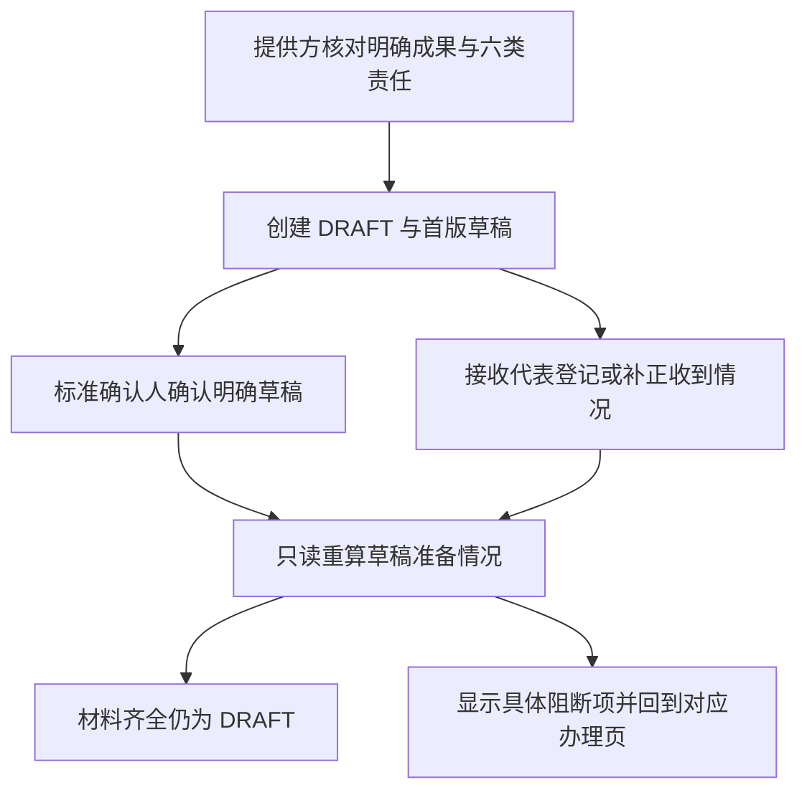

# 业务签收页面流程稿

状态：**DESIGN ONLY**，2026-10-24，基线 `73e6f3f1`。本文是页面职责和文案方案，没有开发页面或接入新 API。真实来源 UNCONFIGURED，业务写入口关闭；原库、Agent API、模型/执行边界及 Draft 状态不变。业务规则归[第一切片契约](../architecture/business-acceptance-draft-receipt-admission-v1.md)，来源判定归[可信依据清单](../architecture/business-receipt-trusted-basis-v1.md)。

## 1. 沿用的完整流程

保留现有侧栏“业务签收 / 业务验收 / 业务归档”，复用 `/identity` → 本人负责成果 → `/core/acceptance-basis` → `/core/acceptance-context` 的身份、目标选择、材料详情及标准/责任历史流程。不是在各页复制一个新向导，也不增加顶部重复菜单。

| 能力 | 直接复用 | 将来需要适配 | 本轮处理 |
|---|---|---|---|
| 身份与目标 | 独立逐用户身份、空间及本人目标选择 | 企业映射和实际来源 | 保持未配置和只读 |
| 签收前核对 | 当前业务依据页的三块核对、材料详情和分页 | 受控接纳事实的版本化安全展示 | 只定义差异，不变更现有 v1 GET/DTO |
| 标准和责任历史 | 现有标准选择、完整条款及责任/代表/处置历史 | 本单固定参与人和精确草稿确认 | 沿用完整返回流程，不另建标准库 |
| 签收办理 | Demo 中四种结果、原因、补正和历史的页面职责 | 独立 Core 事实、本人权限、CAS/回执 | 设计正式流程，不复用 Demo handler 或存储 |
| 原演示页面 | `/#business-*` 的正常/异常演示 | 可复用纯展示组件 | 保留明确演示标记；本轮不退休、不迁移记录 |

## 2. 当前只读模式的页面线框

以下是未来页面展示方案，不声称原型已新增控件。

```text
业务签收 / 签收前核对                        [只读核对]
返回成果列表    核对标准与责任历史

明确交付 ID · 明确成果版本 · 当前工作空间

① 本人和接收责任     身份映射 / 代表关系 / 当前有效性
② 交付和标准         ISSUED 含义 / 明确标准版本 / 适用情况
③ 材料引用           出处 / 内容身份 / 接收主体 / 当前核验缺口

当前不能正式签收
  企业来源未配置；材料内容及接收主体尚无可信证明。
  业务写入口关闭；未创建验收单或签收事实。

主要入口：[查看待补依据]     次要入口：[查看材料详情]
```

“查看待补依据”定位缺口区域；“查看材料详情”只按精确 ID 读取。无材料显示空态；标准未选显示待选择；权限不足显示读取资格失效；单条详情失败保留已知列表并显示 UNKNOWN。缺口责任显示 IAM/接收业务/标准/Evidence 角色，实际人员未指定时明确“待指定”，不编造姓名。

来源只读见证发生在建单前，不要求此时已存在本单草稿确认或签收。未来建单也不以“已有本单确认/签收”为条件；页面应将来源/适用可核对与建单后待产生的确认/收到声明分区，不能把后置产物显示为建单前必补错误。

当前模式无保存、确认、补正或“强制放行”的 handler，也不预生成成功业务编号。页面中的未配置、记录完整、内容未证实、业务是否可办分别展示，不合成为一个绿色总分。现有 Demo 中的演练只改变演示状态，不回流 Core。

## 3. 将来第一写切片的办理顺序



上述全是待实现流程。标准确认和签收在建单后分别办理，没有强制先后；修改草稿会使旧确认不匹配。当前第一切片没有 Submission、审核、归档或 READY 状态。

| 页面与进入条件 | 主要内容 / 唯一主操作 | 成功、返回及冲突 |
|---|---|---|
| 业务验收列表 → 新建独立页；当前唯一 PROVIDER | 明确交付/版本、六类责任、来源标准和缺口；未来主操作“创建草稿” | 只在收到匹配回执后进入明确 case；原筛选/页码保留 |
| 草稿详情/编辑；本单 PROVIDER | 当前 DraftRevision 与允许编辑字段；“保存新修订” | 新 revision/hash；取消编辑回原详情；409 展示差异，不自动套入新版本 |
| 标准确认独立页；本单 BASIS_CONFIRMER | 完整来源、精确草稿/hash、适用及职责依据；“确认本次草稿标准” | 成功显示对应 confirmationId；修订后重新确认，不静默改为确认最新版本 |
| 签收列表 → case 的签收详情；当前可读参与人 | 当前声明、来源可用性、精确历史链、准备阻断项；RECEIVER 可进入登记/补正 | 历史详情按指定 receiptId 展示，不把旧记录替换成当前记录 |
| 首次登记独立页；本单 RECEIVER 且尚无签收 | 固定成果/接收主体、四种 outcome、原因、允许的材料；“保存签收记录” | 首次 replacesReceiptId=null；成功回同 case 的明确 receipt 详情 |
| 补正独立页；本单 RECEIVER 且已有当前签收 | 原 receiptId/outcome/材料；新 outcome 与原因、材料；“保存补正记录” | 原 ID 和 expectedRevision 固定；并发冲突先重读，已输入内容不自动转为新请求 |
| 草稿准备情况；当前可读参与人 | 分列责任、当前草稿确认、当前签收及其材料缺口；历史单独展开 | 齐全显示“草稿材料齐全”；旧签收专属材料失效不误伤新签收，仍无提交/验收通过/归档入口 |

正式路由沿用现有设计的 `/core/business-acceptances`、`/core/business-receipts` 及明确 case/receipt 子路径，尚未注册。材料核对继续复用 `/core/acceptance-basis`。正式入口不得调用 `/#business-*` 的 handler、读取其 sessionStorage 或在正式 GET 失败后降级演示记录。

## 4. 表单与文案约束

- 人员和接收主体由服务器可信上下文确定；无角色切换器、任意 actor 输入或“代表任何人”选择。提供方、标准确认人、接收代表分别办理。
- RECEIVED 需非空原因及至少一条满足来源接纳条件的材料；部分收到/未收到/争议也需原因，可无附件，但始终阻断准备齐全。表单只提交 evidenceIds，不提交“已验证”或 URI。
- 展示“平台记录完整”时同时区分“内容身份”“收到声明”“接纳当前有效性”；“授权释放”不改写为“已收到”，“已收到”不改写为“验收通过”。
- 草稿保存、标准确认、收到登记与技术命令回执分开显示。对话框可以做最后核对，不在列表中混放完整签收表单。
- 键盘顺序为固定目标→结果→原因→材料→核对→主操作；控件有名称、必填和字段错误关联。来源不足时保留解释入口和可见焦点；390px 下不让长 UUID/hash 挤掉返回或主要入口。

## 5. 刷新、回跳和未决结果

| 场景 | 页面行为 |
|---|---|
| 列表、材料分页和历史返回 | 保留明确空间、交付/版本、标准、case/receipt ID 及页码；只用有限内部返回状态，不接收任意 returnTo URL |
| 消息指向旧签收 | 当前身份重新鉴权，校验 case/receipt 从属；展示原签收和“已有后续补正”链接，不替换为最新 |
| 刷新已保存详情 | GET 恢复精确服务器事实；sessionStorage 不证明成功，不恢复未保存 PASS |
| 切换身份/空间/case | 清理未保存输入、材料选择和动作资格；丢弃旧上下文迟到响应；原 UNKNOWN 意图留在其服务端主体恢复记录 |
| 请求结果 UNKNOWN | 显示原意图待核对，禁止换键补建；仅查询原回执，404 是 NOT_OBSERVED，不是未执行 |
| 持续 NOT_OBSERVED，希望恢复原意图 | 未来受控“恢复原请求”先展示原命令/目标/key/指纹及原 body 摘要。当前关闭时不提供 POST；另行授权启用后，仅本人同空间经当前准入发送原四个 Command 之一的原键/原 body，不静默换 revision/材料，不自动重试 |
| 回执已确认、详情读取失败 | 保留“命令已确认，当前详情未知”；只读刷新详情，不再次保存 |
| 旧成功回执对应的 case/签收/来源已变化 | 在当前 READ/本人范围内仍恢复原 resultingRevision/事实 ID；另外 GET 当前详情，不用当前 DRAFT/CAS/材料资格重新否定旧成功 |
| 角色写资格撤销但 READ 仍有效 | 可按原主体恢复本人已提交回执与可读历史；新办理被拒绝 |
| 身份或空间 READ 撤销 | 停止显示旧缓存；重新认证不能让替任人接管原未决请求 |

当前写入口关闭，因此本轮不会产生这些新 Command 意图或恢复记录。未来页面验收以[异常矩阵](business-receipt-exception-acceptance-matrix-20261024.md)为准，不将本页流程图当作浏览器已通过证据。

原键恢复需要写运行边界和当前新写资格，不因为名为“恢复”而成为只读功能；全局停用只保留已实现且当前授权允许的回执/历史 GET。恢复记录丢失或原 body 无法核实时不生成替代键，沿用契约的 UNKNOWN/人工核对路径。旧成功回执的读取则不要求仍具备新写资格；两类恢复不得共用一个“有 READ 就重新发送”的按钮。
