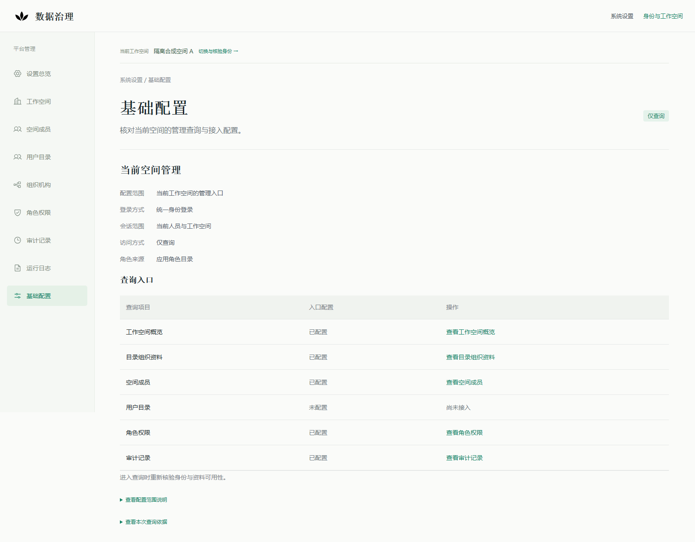

# 组织与成员目录：产品只读配置与独立验收

2026-10-26，承接`dc9089c744558bf56db9363672a87e347e2bc558`（基线16项CI已完成成功），本轮获准实现组织与成员目录的产品级私有配置，并验收实际产品入口。当前实现HEAD的CI另行核对，不继承基线绿色。PR #363继续Draft，不合并、不部署。

## 1. 本片交付和复用

在现有[Profile](../../apps/platform/internal/platformmanagement/service/profile.go)增加可省略的directory，复用[目录装配](../../apps/platform/internal/platformmanagement/service/directory.go)、既有ZITADEL只读Adapter、Casbin角色目录、OIDC/RP、当前PG资格及共享Compose，接入原cmd/api的QUERY_ONLY分支。新增私有配置描述，不新增API、IAM、同步/采集服务、数据库表或迁移、业务命令及依赖。

本片只装配OrganizationReader、Directory和应用角色Catalog。即使现有原生Client还实现用户查询，也不把它赋给Users或IdentityLinks；用户资料、人员关联和运行日志仍未配置。审计继续独立装配；配置页仍是六键公开投影，不成为配置编辑器。

Reuse Check：现有能力已满足全部查询语义；缺口是把显式私有配置交给产品组合根。ZITADEL原生查询与现有Adapter优先复用，OIDC/Casbin保持现状。Keycloak等成熟身份方案可作为未来真实来源候选，但本片没有替换IdP或引入第二套IAM的业务依据；若未来来源协议不兼容，按既有Port评审Adapter，不能用本片强迫企业选型。无新OSS、Fork或通用配置中心。

## 2. 私有配置与启用边界

权威字段及行为见[装配方案](../architecture/platform-management-main-service-readonly-v1.md#10-组织与成员目录的产品配置)。[配置模板](../../deploy/management/directory-query.example.json)只有占位符、无凭据；零workspace UUID保证不能直接启用，必须替换为经过确认的实际材料和本机绝对路径。模板不是执行或真实接纳授权。

directory缺省/null时不创建目录客户端、不读取目录凭据；所选配置不完整或非法即固定安全错误退出，不回退全量主服务、其他空间、默认目录、旧缓存或fixture。只支持source=CONFIGURED、provider=ZITADEL和显式workspace→organization/project绑定；来源独立HTTPS origin、CA文件及只读凭据文件，角色仅接受既有查询权限白名单。目录角色不创建或补足caller grant。

启动只构造Adapter，不探测来源；health/ready仍核验必需库/schema/权限，不宣称目录健康。查询时沿用原生权限前后确认、精确组织/项目、完整筛选分页、当前caller及原期限复核。关闭时回收自己创建的目录连接，不改原库、旧IdP、Agent宿主或原预览。

**CONFIGURED仅说明存在显式运行配置，不能证明来源真实或已接纳。** 本轮实际cmd/api只能接受产品schema中的CONFIGURED；其连接的是固定loopback合成IdP/目录和新库，验收报告明确ISOLATED_SYNTHETIC/realSources=UNCONFIGURED，空间标签明确“隔离合成”。没有给产品增加SYNTHETIC_FIXTURE或测试模式开关，也不能把这些合成配置复制到默认预览冒充企业接入。

## 3. 实际产品入口验收

新环境固定为management_directory_product_20261026（PG loopback 25580）、实际cmd/api 18580、合成IdP/原生协议源19180、新版Web https://localhost:4380。A/B显式映射不同目录组织；C有合成caller资格但无目录绑定，用于证明不会默认落到A/B。全部身份、来源、角色、会话及业务seed均为新独立环境，不从真实业务或人员推定。

准备脚本只用tests宿主做新库迁移和seed，运行服务另行构建cmd/api并仅传PLATFORM_MANAGEMENT_PROFILE；tests宿主在本模式拒绝充当运行API。独立API为SELECT-only；RP仅有既有临时会话必要写权限；验收控制方与运行角色分离。

| 验证 | 实际结果及限度 |
|---|---|
| Go及独立PG | 6个有测试包，284个pass事件（含子用例），0 fail/skip；含新配置/嵌套歧义/非法权限/凭据/懒装配与现有真实PG权限边界；[结果](platform-management-directory-product-20261026/go-regression.json) |
| 实际main子进程 | 12项PASS：11种非法或越界配置拒绝启动；一个省略directory的有效进程可ready；缺省无依赖由单元/代码及入口行为分层证明；[结果](platform-management-directory-product-20261026/product-contract-results.json) |
| 新版Edge | 24项PASS：六键配置、58条25/25/8、角色→成员筛选→第二页→详情→原条件/焦点、组织往返、用户/日志未接入、A/B/C隔离、来源故障、读取中令牌撤销/到期、grant停用/能力撤除/期限失效、RP历史/刷新、封闭路由及移动布局；[结果](platform-management-directory-product-20261026/browser-edge-results.json) |
| 新版Chromium | 同一独立实际产品入口24项PASS，供CI浏览器一致性复核；[结果](platform-management-directory-product-20261026/browser-chromium-results.json) |
| 历史与秘密 | 读取路线前后AuditEvent、execution、Agent任务/请求、delivery provider attempt、outbox条数/内容摘要不变；无越界浏览器请求、业务写请求或pageerror，HTML与浏览器存储无来源凭据 |
| 保留资源 | 普通及python -O保留回归各13项PASS；original固定名容器前后均不存在，management/runtime/首片main-service/前片compat前后存在且比较PASS；[安全摘要](platform-management-directory-product-20261026/retained-comparison.json)。仅元数据证明，不访问原库SQL/DDL、不证明原库内容 |

“只读”指产品查询及业务入口。独立环境的DDL/seed、grant/令牌/来源权限控制和RP会话技术写分别记录，不声称整个测试环境零写。负向配置子进程仅由其Popen句柄回收；常驻环境有私有进程/资源账本。修复焦点时只替换经过PID、创建时间、绝对node/入口路径和4380监听端口核对的本轮Web；旧构建/日志/账本、API/新库/IdP及先前预览保留。

## 4. 发现、修复与失败历史

首轮Edge发现原列表锚点正确但键盘焦点依赖浏览器默认行为，刷新后无法稳定回到指定行。新增[ManagementRowFocus](../../apps/web/components/management-row-focus.tsx)，只聚焦已授权渲染列表中匹配member-/user-前缀的TR，解码非法片段直接忽略；不发请求、不改变空间或恢复缓存数据。成员及既有用户列表复用同一组件，保留完整GET重新核验和原焦点断言。

后一轮负向用例曾错误预期“停用空间grant”为403；实际现有身份契约返回401。保持后端语义，拆开精确断言：令牌/身份/空间资格失效401，单独撤除管理查询能力403；增补独立grant期限到期验证，没有接受模糊状态码集合。首次组织Adapter单测还曾使用错误的原生状态枚举，修正的是测试夹具，未放宽Adapter。

[失败历史与范围](platform-management-directory-product-20261026/failure-history.json) · [原焦点失败](platform-management-directory-product-20261026/browser-focus-before-fix.json) · [原状态码预期失败](platform-management-directory-product-20261026/browser-grant-expectation-failure.json)。失败和后续NOT_RUN不计为通过，不覆盖原结果。

## 5. 页面、重演与CI

截图均为实际产品入口上的合成记录，已目视核对：

[组织资料](platform-management-directory-product-20261026/organization.png) · [成员详情](platform-management-directory-product-20261026/member-detail.png) · [原筛选/第二页/行焦点](platform-management-directory-product-20261026/member-return.png) · [移动页面](platform-management-directory-product-20261026/mobile.png) · [Git字节清单](platform-management-directory-product-20261026/manifest.json)

只在另行明确的新独立环境，设置MANAGEMENT_FIXTURE_ACK=ISOLATED_READONLY_MANAGEMENT和MANAGEMENT_DIRECTORY_PRODUCT_FIXTURE_ACK=ISOLATED_DIRECTORY_PRODUCT_READONLY，依次运行：

1. 运行 `python tests/platform-management/run.py --suite directory`；已有目录、容器或端口仍拒绝覆盖，不删除旧目标重新准备。
2. 统一入口按原顺序执行 Go/PG、产品合同（如适用）、独立 Web、原浏览器验收及最终保留比较。本地默认 Edge，CI 显式 Chromium；实际产品 API 和权限边界保持。
3. 成功、失败或中断后在 finally 停止本轮容器与关联进程，保留数据、配置、日志、截图和原始失败证据。不重置旧身份/数据，也不上传 profile、凭据或原始私密日志。运行及中断恢复遵循[验收收尾契约](../operations/acceptance-shutdown.md)。

CI加入同一实际入口准备、Go/PG、子进程、Web、浏览器及保留检查，只上传固定安全JSON和截图，不上传私有profile、源凭据文件、DSN、证书/密钥、进程/资源原始账本或原始日志。此实现HEAD的完整CI以PR最终闭环评论核对，旧dc9089c7绿色不能替代。

## 6. 真实接纳仍待定

实际场景、组织、工作空间、IdP和目录实例/版本、只读权限、映射和确认责任仍按[来源清单](platform-management-source-admission-20261026.md)待定，9类来源与12项材料无真实通过项。产品配置能力不是来源接纳，也不是运行启用授权。

默认新版预览仍未接入，不替换原OIDC/RP或Agent API，不访问或迁移原库。用户详情、显式身份关联、日志产品配置、正式空间生命周期及管理/业务写入口均未在本片启用；模型和真实派发关闭。真实只读联调、部署/启用及合并另有边界，PR继续Draft。

## 7. 本轮CI的历史缓存与登录落地补修

提交d57bd10d的完整CI已完成：14项成功，identity及required失败。身份作业在既有日志19项验收的最后零错误断言捕获一次React 418，记录发生在资格/令牌到期后的登录路线；前18项通过，新增目录和后续共享组合步骤NOT_RUN。[原CI报告](platform-management-directory-product-20261026/ci-runtime-before-retention-fix.json)继续保留，不能用本机目录24项绿色代替。

复核发现历史保护在pagehide.persisted=false的普通跳转也flushSync卸载树。已将卸载限定为浏览器保留文档的persisted=true：仍由React清空记录，pageshow.persisted仍强制完整GET重新核验；被丢弃的普通文档无须卸载。单测新增普通离开不得清空、保留离开必须清空；旧无条件实现触发确定失败，修复后12项PASS。

本机原时序未精确复现418。补修后的首轮复核还出现新登录后身份状态而无记录（pageErrors为空），[该失败](platform-management-directory-product-20261026/local-runtime-before-landing-fix.json)与[先前默认时间窗诊断失败](platform-management-directory-product-20261026/local-runtime-before-retention-fix.json)保留，不混同为hydration重现。验收登录原先等待任意同源URL，可命中回调而非最终页；现统一等待固定/settings的load，日志路线额外核对既有“设置总览”标题后继续。期间一次标题预期误写“系统设置”，已修正测试且[保留失败](platform-management-directory-product-20261026/local-runtime-landing-label-failure.json)。未改产品文案、身份到期语义或放宽权限。

在经PID、创建时间、绝对node/脚本路径和4370监听核实后，仅替换前片自己的候选Web为独立history02构建，保留旧账本、构建、API、IdP和新库。串行[Edge日志19项](platform-management-directory-product-20261026/runtime-history-edge.json)与[Chromium日志19项](platform-management-directory-product-20261026/runtime-history-chromium.json)全部PASS、pageErrors为空；覆盖普通pagehide保留当前页、保留pagehide清空、恢复后真实新查询以及原全部权限/分页/历史断言。[补修范围](platform-management-directory-product-20261026/runtime-history-fix.json)明确确定回归与未精确重现的区别；没有屏蔽错误、sleep或重试。最终以补修新HEAD完整CI及新目录产物核对，原失败和NOT_RUN不改判。

登录就绪调整同步覆盖既有管理、首片main-service和本片目录脚本。故意拒绝的登录另以显式accepted=false等待/auth/callback并保留“登录未完成”断言，不把失败身份也当成成功落地；首次仅等待成功落地导致的[负向验收失败](platform-management-directory-product-20261026/management-landing-denial-failure.json)保留。最终[共享管理Chromium51项](platform-management-directory-product-20261026/management-landing-chromium.json)和[目录Chromium24项](platform-management-directory-product-20261026/directory-landing-chromium.json)全部PASS。目录复核继续使用本轮已运行的实际cmd/api/4380，不重置API、IdP、PG或过期会话；日志修复新构建在4370，共享设置也在该新构建验收。

## 8. 重复CI失败仍阻断；只增加有界诊断

6e795473的CI已完成，仍为14项成功、identity/required失败：[第二次失败](platform-management-directory-product-20261026/ci-runtime-second-failure.json)在默认时间范围/刷新阶段记录React 418，随后的历史保护零错误断言阻断，目录步骤继续NOT_RUN。上一节的生命周期与落地补修未消除根因，不能宣布已解决或冻结为完整绿色候选。

[本机诊断范围](platform-management-directory-product-20261026/hydration-diagnostic-summary.json)包括共享组件开发版20组、全站外壳开发版8组/生产版8组、全新独立Next/OIDC/PG开发版19项，以及CPU速度与脚本加载延迟18组。均未重现，不当作Linux失败的反证或根因修复证明。为取得可读错误，新复制诊断环境仅改测试宿主的固定合成坐标与开发宿主；产品源码与业务边界保持不变。初次不完整的源码复制缺少migration目录，准备失败及其新资源单独保留；未清理、重置或延长旧库/旧资格。

下一提交仅给原日志浏览器用例增加只读诊断：页面离开/恢复的原生persisted、pathname（无query）、相对时序；首个完整表格与错误时的有界DOM标签结构，不含文本、id、属性值、参数、引用、Cookie或凭据。不删除/修改DOM、不替换事件、不屏蔽错误、不增加重试；原零错误断言继续阻断。新提交仍需以最新HEAD的完整CI及目录产物核对；在此之前该浏览器阻断保持OPEN。真实来源、默认预览、业务写入、模型与真实执行边界均未改变，PR继续Draft。

诊断记录区分原生/合成事件的isTrusted，保留最后400项并报告丢弃计数。该监听器在新4410开发宿主的19项流程验证通过；另一轮开发工具的栈帧POST被原有零写断言阻断，私有失败保留，未放行该路径或当作生产写入。开发版检查不替代生产CI，也未提供418根因重现。

## 9. 2026-10-27：慢速文档流的渲染边界定位与补修

924fdbd4随后取得[16项完整绿色](platform-management-directory-product-20261026/diagnostic-head-ci.json)，新目录CI产物也实际完成[Go/PG284个pass事件、实际main12项、目录24项及保留检查](platform-management-directory-product-20261026/directory-ci-924f-summary.json)。这没有排除已知问题：本机用Chromium已有的Network.emulateNetworkConditionsByRule仅限制日志HTML文档传输，保持脚本正常加载，在32000/8000 Bps条件下记录3次同型React 418。[失败报告](platform-management-directory-product-20261026/hydration-network-before.json)中的导航/行数断言完成不等于还原通过，整体verdict明确FAIL。

在未修改框架或产品行为的CDP断点中，确认document仍为loading，React期望结果区SECTION，但下一还原游标已指向其内P（parent=SECTION）；[安全断点记录](platform-management-directory-product-20261026/hydration-breakpoint.json)只有节点类型和渲染祖先，无节点文本、引用或凭据。问题定位到服务端内容分段穿过客户端历史保护组件时缺少明确的还原边界；此前pagehide/登录落点调整不能代替这项修复。

现复用已依赖React的Suspense，在RuntimeLogNavigation内为服务器日志内容建立明确边界，分段未就绪时只显示“正在读取运行记录…”。保留服务器查询、SSR、当前身份核验和完整GET；没有关闭SSR、屏蔽警告、放宽零错误或加入重试，也没有更换/修改React或Next依赖。同一隔离生产环境[3档相同网络条件](platform-management-directory-product-20261026/hydration-network-boundary-candidate.json)均零错误。

该等待边界还暴露了焦点时序：[候选Chromium失败](platform-management-directory-product-20261026/runtime-boundary-focus-failure.json)表明外层历史effect可能早于实际行就绪。复用已有ManagementRowFocus，增加显式log-前缀，在同一已授权列表边界内恢复当前#management-main中的TR；不查询、切空间或恢复旧数据。原返回条件、页码、片段、焦点和刷新断言保留。

最终生产候选的[Edge20项](platform-management-directory-product-20261026/runtime-hydration-final-edge.json)、[Chromium20项](platform-management-directory-product-20261026/runtime-hydration-final-chromium.json)均通过且pageErrors为空；新第4项专门用32000 Bps日志文档覆盖指定查询→默认窗口→刷新→指定查询，仍保留最终全程零错误及无业务写入/外联断言。[最终32000/8000 Bps复核](platform-management-directory-product-20261026/hydration-network-final.json)零错误，Web单测12项通过。[范围摘要](platform-management-directory-product-20261026/runtime-stream-boundary-fix.json)区分定位、候选与最终验证。

仅替换经PID、创建时间、绝对node/入口和4410端口核实的本轮临时诊断Web，API、合成IdP、新库、先前构建/失败报告及旧会话保留；[旧容器元数据比较](platform-management-directory-product-20261026/retained-hydration-comparison.json)PASS。没有访问原库SQL/DDL、延长旧凭据、接纳真实来源或切换默认预览。本修复最新HEAD的全量CI及20项日志产物仍须另行核对并在PR闭环评论记录，不继承924fdbd4绿色；业务写入口、模型、真实执行和合并均继续关闭。
