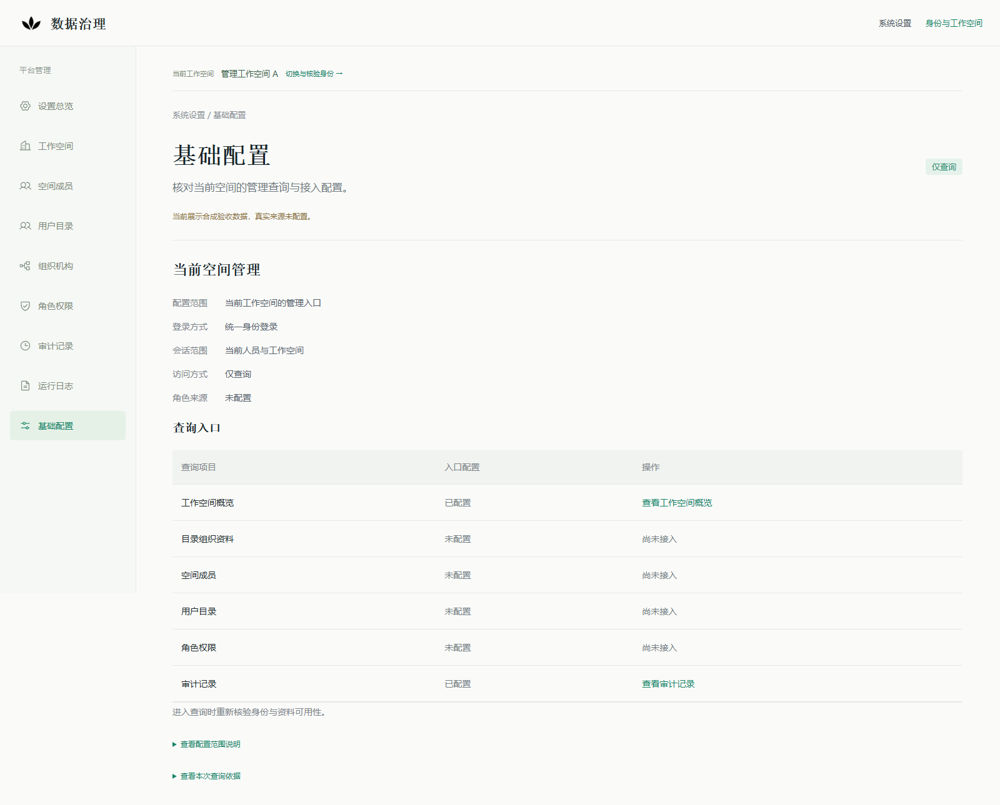

# 系统设置主服务只读装配：第一切片实施与验收

2026-10-26，承接设计提交`2a6f6099e7716dc4693db51147cfc88ab863b95c`，该文档HEAD的16项CI已完成并成功。本轮用户授权第一实施切片及独立合成验证；本实现提交的CI另按最新HEAD记录，不继承旧绿色。PR #363保持Draft，不合并、不部署。

## 1. 本片结果和边界

已在[cmd/api](../../apps/platform/cmd/api/main.go)增加默认关闭的QUERY_ONLY分支，复用[共享组合](../../apps/platform/internal/platformmanagement/service/composition.go)、现有OIDC/RP、当前PG资格与管理/日志查询Handler。所选profile无效即拒绝启动，不回退全量主服务、默认DSN或fixture；默认未选不创建新增管理依赖。没有引入IAM、通用策略/HTTP框架、依赖、迁移、业务表或Command。

审计查询已独立于目录/Catalog，使用显式workspace→AuditBinding.Source/Reader，成功/失败共同走后置身份与资格检查，输出前保留原最短期限。工作空间、基础配置两个入口投影及Web DTO同步修正；字段/版本/六个配置键、管理读能力、审计事实/分页合同均保留。详见[管理权威契约](../architecture/platform-management-readonly-v1.md#审计独立装配)及[装配方案](../architecture/platform-management-main-service-readonly-v1.md)。

产品profile当前仅支持身份、专用资格库及可选审计，默认不配置；目录/日志产品配置和新组合完整兼容路线仍后续。测试通过同一Compose注入合成Port，不为产品增加合成开关；真实来源继续UNCONFIGURED，默认4193/4493预览不切profile，Agent API和原OIDC/RP运输方式保留，业务写入口、模型和真实派发关闭。未连接企业IdP/目录、真实日志或原库。

## 2. 隔离环境与权限

新合成环境独立使用数据库management_main_service_20261026（loopback 25560）、API 18560、IdP 19160、Web https://localhost:4360，以及新的RP临时会话与Edge上下文。固定目标/ACK/已有目录、容器、端口防覆盖检查保留；完整资源/进程和凭据账本仅在私有.data目录，不进入仓库或artifact。

API角色只能SELECT身份三表及显式启用的audit_event；不配置审计时必须撤去该表读权限。校验TLS、目标库/角色、主库、只读默认、schema字段、表/列读写、序列、非系统schema函数及角色/ownership边界；额外业务表SELECT、列SELECT/UPDATE亦阻断。RP角色仅有两张临时会话表的必要SELECT/INSERT/DELETE。身份确认事务显式使用READ COMMITTED/READ ONLY，仍复用现有资格fence。

prepare/migration/合成身份和AuditEvent seed、ACL改变、撤权/到期、表锁和取消查询均为这一个新库的验收控制动作，不是产品写API或真实故障演练。测试前后核对audit_event、execution、agent_task、agent_action_request、delivery_provider_attempt、outbox_event条数及内容摘要；浏览器路线未改变这些业务事实。

本机original固定名容器在前后观察均不存在，management/runtime固定名容器前后存在且完整保留比较PASS。这里只证明观测到的容器元数据，不证明原库内容；本轮未访问原库SQL/DDL，也未删除或重启旧容器。只更新经PID、启动时间、绝对可执行路径和监听端口核实的本轮候选API进程，保留所有前次二进制、日志和账本。

## 3. 验证记录

| 验证 | 实际结果与限度 |
|---|---|
| 失败先行 | 无目录审计503、审计失败跳过后置身份、前端拒绝audit-only DTO均先有失败回归，修复后通过 |
| Go完整相关包及真实PG | 6个有测试包共214个pass事件（含子用例），0 fail/0 skip；涵盖真实当前grant/事务、审计同时间分页、列级权限、全部可选源关闭下的实际OIDC/TLS HTTP以及main拒绝回退 |
| 独立Edge | 最终18项PASS：独立审计、六键配置、闭集路由、真实DML/DDL拒绝、RP权限、58条同微秒25/25/8、跨空间/caller、详情展开/返回/刷新/历史、来源故障、读取中撤权/取消、到期与恢复不复活、无外部/目录请求和业务事实变化 |
| Web回归 | test:iam共32 pass、2个可选DB用例skip，日志保留；不把skip当PG证明，实际RP/PG由上述Edge及Go验证 |
| 产品构建 | cmd/api实际构建成功，真实main子进程无效profile拒绝回退通过；正向产品进程连接真实来源NOT_RUN，共享测试组合不冒充真实部署 |
| 容器保留 | 普通及python -O保留回归各13项通过；本片前后original/management/runtime只读比较PASS，UNKNOWN或真实变化仍阻断 |
| 未运行范围 | 新组合已配置目录/日志的完整角色→成员→详情路线、日志绑定/到期/26条完整兼容、原4193/4493现场重演及一切真实来源启用NOT_RUN |

上述只读指产品查询与业务写入口，不声称验收seed/控制或RP临时会话完全没有数据库写。历史失败不覆盖：[失败摘要](platform-management-main-service-20261026/failure-history.json)。首轮启动权限检查遇到SQLSTATE 42809，已使用CASE显式限制sequence权限函数的对象类型，没有放宽权限检查。首轮Edge用例误将实际OIDC跨空间401期望为403，核对现有Resolver后修正为精确401，仍要求错误无data；最终18项均重新验收。缺失工具链和一次测试编译失败也单独留存，不能当有效回归结果。

[最终Go/PG摘要](platform-management-main-service-20261026/go-regression.json) · [最终Edge结果](platform-management-main-service-20261026/browser-results.json) · [安全容器保留报告](platform-management-main-service-20261026/retained-comparison.json) · [字节清单](platform-management-main-service-20261026/manifest.json)。公开结果不含原生配置、绝对宿主路径、卷名、token、Cookie、密码或原始诊断；截图全为合成数据，已目视核对：

[审计列表](platform-management-main-service-20261026/audit.png) · [工作空间入口](platform-management-main-service-20261026/workspace.png)

## 4. 重演与停止条件

只在另行明确的新独立环境执行tests/platform-management/bootstrap.py，需MANAGEMENT_FIXTURE_ACK=ISOLATED_READONLY_MANAGEMENT及MANAGEMENT_MAIN_SERVICE_FIXTURE_ACK=ISOLATED_MAIN_SERVICE_READONLY；当前固定目标已存在时必须拒绝，不能删旧目录/容器后重跑或改为原库。随后test-main-service.py验证相关Go/PG，start-web.py --build使用独立.next-acceptance-identity-management-*构建，main-service-browser.mjs运行Edge（CI显式Chromium），verify-main-service.py作最终只读保留比较。

现有环境若需经修复再次验收，必须使用新的Go/浏览器/保留报告名称，保留历史结果；只允许核实并替换本轮拥有的候选进程，不重建或重置DB/IdP/原会话。CI已复用同一准备与验收路径，只上传固定安全JSON和截图，不上传profile、api-config、web-env、原始保留快照、进程/凭据账本、证书或密钥。

实际企业场景、组织、人员/责任、来源、版本和材料仍待定，来源清单无新的通过项。真实接纳、部署/启用、原库DDL、修改真实grant、业务写入口、模型/派发及合并继续不在授权范围；身份/空间泄漏、权限扩大、元数据真实变化/UNKNOWN或其他契约冲突即停止。
