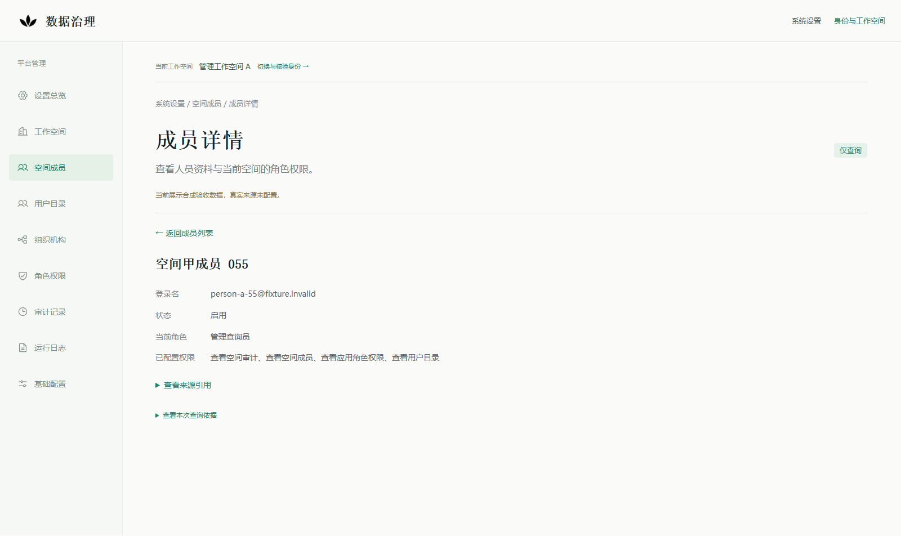

# 系统设置主服务只读装配：目录与日志兼容验收

2026-10-26，承接第一切片提交`988bddf9eb74ec9077ab612d21c3054b3a638d0a`；该基线16项CI已完成并成功。本轮用户授权复用现有目录和日志Port，通过同一共享组合完成独立合成兼容验收。当前提交的CI按最新HEAD另核对，不沿用基线绿色。PR #363保持Draft，不合并、不部署。

## 1. 交付范围

测试宿主现在将既有ZITADEL目录Adapter、应用角色Catalog、审计Reader、RuntimeSources、OIDC Resolver及PostgresGate注入同一个[service.Compose](../../apps/platform/internal/platformmanagement/service/composition.go)。目录七项GET、日志三项GET、私有身份确认和health共用封闭查询路由，无新API、依赖、迁移、策略引擎、日志采集或业务功能。

这一步证明共享组合能够承载已有能力。产品profile仍只支持身份、专用资格库和可选审计；拒绝目录、runtimeSources及测试开关键，不开放产品目录/日志配置。真实来源UNCONFIGURED，默认新版预览保持未接入；原库、原OIDC/RP及Agent API保留，业务写入口、模型和真实派发关闭。

## 2. 发现和根因修复

原管理Handler在成员、用户、组织读取失败、缺失或返回非法数据时提前响应，漏过共同的读取后身份复核。真实合成OIDC/HTTP反例先证实：成员来源权限失效叠加caller令牌撤销时返回503，而不是既有401身份拒绝。

现将全部来源观察先留在请求内，共同经过无缓存Resolver、原身份revision、当前PG资格及初次/后查最短期限，才输出记录或错误。有效caller仍得到原有来源错误；失效caller优先401/403、无data。原始期限适用于成员/用户/组织等全部管理响应，不能被后查新期限续长；审计独立装配和历史事实规则保留。权威语义见[管理契约](../architecture/platform-management-readonly-v1.md)。

日志契约不变。补测在共享Compose中验证来源binding/rule版本变化、原始引用到期，以及原生26条lookahead必须完整校验后才可截取25条；不增加产品时钟或测试控制入口。

## 3. 独立环境和实际证据

新库management_main_service_compat_20261026，仅loopback 25570；API 18570、合成IdP 19170、新版Web https://localhost:4370。新RP临时会话、Edge上下文、TLS材料、进程和资源账本独立保留在私有.data。固定ACK/目标校验拒绝覆盖已有环境；前一切片及原预览不切换。只替换经PID、创建时间、绝对exe路径和监听端口确认属于本轮的候选API，旧二进制及日志保留。

| 验证层次 | 结果与范围 |
|---|---|
| Go及真实独立PG | 6个有测试包，259个pass事件（含子用例）、0 fail、0 skip；包括新来源观察门禁、原期限、配置拒绝、共享日志绑定和lookahead；[结果](platform-management-main-service-compat-20261026/go-regression.json) |
| 新版设置Edge | 51项PASS：角色→相关成员→精确详情→原列表，筛选/页码/选中行/来源恢复，组织/用户/配置/审计往返，跨空间、撤权、到期、刷新和移动布局；[结果](platform-management-main-service-compat-20261026/management-browser-results.json) |
| 日志Edge与实际HTTP | 18项PASS：查询/筛选、58条同纳秒及相邻记录25/25/8无重漏、详情/返回/刷新、双权限、读取中撤权/到期、错误/缺失/变化、引用隔离及超时；[结果](platform-management-main-service-compat-20261026/runtime-browser-results.json) |
| 额外负向HTTP | 3类目录读取×3类caller失效=9项PASS，另业务事实条数/内容摘要不变1项PASS；使用Playwright APIRequestContext，不冒充10项UI用例；[结果](platform-management-main-service-compat-20261026/boundary-results.json) |
| 共享组合单元边界 | binding/rule在成功/失败、列表/详情读取中变化均拒绝；旧引用不再到源，原期限不续长。26条反例覆盖重复、乱序、服务/级别/事件、时间和外空间；这是Handler/Adapter证据，不冒充真实日志来源接纳 |
| 容器保留 | 普通及python -O各13项PASS；original固定名在前后均不存在，management/runtime/前片main-service前后存在且比较PASS；[安全摘要](platform-management-main-service-compat-20261026/retained-comparison.json)。仅元数据观察，不证明原库内容；未访问原库SQL/DDL |
| CI | 已加入同一workflow的独立准备→Go/PG→Web构建→负向HTTP→设置51→日志18→保留检查，严格串行；只上传固定安全JSON/截图。当前HEAD结果在PR闭环评论核对 |

只读指运行API与业务边界。prepare/seed、资格/来源撤权及到期控制属于新库/合成IdP；RP会话有必要技术写，不能称整个验收环境零写。两条页面路线对AuditEvent、execution、Agent任务/请求、delivery provider attempt、outbox条数和摘要的检查保留，未通过产品路径改变业务事实。

首轮负向HTTP失败和一次本地编排失误均保留：[失败历史](platform-management-main-service-compat-20261026/failure-history.json)。后者因Go集成测试和页面验收共用新库并发运行，Go新增合成审计记录触发浏览器原有历史hash断言；没有改断言或在运行中重置基线，最终先完成Go，再串行跑HTTP/51/18，全通过。历史失败不覆盖、不计为PASS。

## 4. 页面证据与重演

截图均是新组合上的合成资料，已目视核对：

[原条件/第二页/选中行恢复](platform-management-main-service-compat-20261026/members-return.png) · [六键公开配置](platform-management-main-service-compat-20261026/configuration.png) · [日志列表](platform-management-main-service-compat-20261026/log-list.png) · [精确日志详情](platform-management-main-service-compat-20261026/log-detail.png) · [失效位置](platform-management-main-service-compat-20261026/log-expired.png) · [文件字节清单](platform-management-main-service-compat-20261026/manifest.json)

仅在新的明确隔离环境依次执行以下既有脚本，设置MANAGEMENT_FIXTURE_ACK=ISOLATED_READONLY_MANAGEMENT及MANAGEMENT_MAIN_SERVICE_COMPAT_FIXTURE_ACK=ISOLATED_MAIN_SERVICE_COMPAT_READONLY，构建目录MANAGEMENT_WEB_DIST=.next-acceptance-identity-management-main-service-compat-20261026：

1. tests/platform-management/bootstrap.py准备新固定目标；已有目录、容器或端口即拒绝，不能删除旧目标重跑。
2. tests/platform-management/test-main-service.py完成Go/PG后，再start-web.py --build；不与其他验收控制并发操作同一新库。
3. tests/platform-management/compat-boundaries.mjs、browser.mjs、tests/runtime-logs/api-browser.mjs依次执行；本机默认Edge，CI显式Chromium。最后verify-main-service.py只读比较保留资源。
4. 修复后复核已有本轮环境时使用新的Go、HTTP、浏览器、保留报告名，保留前次证据；不重置DB、IdP或其他预览会话。公开artifact不含profile、配置/进程账本、原始保留快照、DSN、token、Cookie、证书私钥或原始日志。

## 5. 后续与停止条件

[装配矩阵](../architecture/platform-management-main-service-readonly-v1.md#8-验收条件与分片状态)A08/A12/A13/A14已补齐本组合的有限合成证据。真实企业场景、组织、来源、维护方、版本和材料仍按[来源与责任清单](platform-management-source-admission-20261026.md)待定；9类来源和12项候选材料没有新增真实通过项。

产品目录/日志配置、实际来源接纳、真实正向产品启动、同进程全站组合、默认预览切换及部署仍未执行；原4193/4493现场本轮未重演。不把本轮合成兼容、截图或CI当作真实接纳或启用授权。身份/空间泄漏、权限扩大、保留元数据真实变化/UNKNOWN、来源回退或业务历史变化即阻断，不放宽条件。无合并、原库变更、业务写入口、模型或真实执行授权。

## 6. CI发现的页面还原异常及补修

提交8f303138的16项CI中14项成功，identity及聚合required失败。身份作业121492917351在原有日志18项验收中，前17项通过，最终零浏览器错误断言捕获一次React hydration 418；新增共享组合步骤因此NOT_RUN。保留[原CI失败报告](platform-management-main-service-compat-20261026/ci-runtime-before-react-fix.json)，不因本地绿色或重跑抹去失败。

复核确认旧pagehide保护直接replaceChildren删除React拥有的节点；针对渲染所有权的回归在旧函数上失败。已将清除操作交给RuntimeLogNavigation的React状态并flushSync卸载，pageshow.persisted仍重新加载、重新核验，不保留旧结果。静态测试宿主拥有独立DOM，显式提供其清除回调；两者复用同一历史监听器，没有新增运行开关、依赖、缓存或存储。

首次CI错误的精确触发时序未在本机重现，不能把所有权单测当完整重现。补修后新独立构建实际Next+OIDC/PG+HTTP的[Edge19项](platform-management-main-service-compat-20261026/runtime-browser-react-edge.json)与[Chromium19项](platform-management-main-service-compat-20261026/runtime-browser-react-chromium.json)均PASS且pageErrors为空，新增受控pagehide清除和persisted pageshow触发真实新查询；[静态Edge16项](platform-management-main-service-compat-20261026/static-browser-react-results.json)和Web单测12项通过。没有屏蔽hydration警告、过滤pageerror、增加自动重试或放宽零错误断言。安全错误诊断只增加当前用例及pathname，不记录URL参数、引用、Cookie或令牌。

[补修摘要与验证范围](platform-management-main-service-compat-20261026/react-history-fix.json) · [补修后保留比较](platform-management-main-service-compat-20261026/retained-react-comparison.json)。前述18项及截图是前一轮实际证据，继续保留；当前日志路线为19项。补修仅替换本轮经所有权核实的4370候选Web，旧构建/进程账本和其他预览保留。最终CI仍须匹配补修后的最新HEAD，不能继承8f303138结果。

## 7. 配置导航验收的目的页就绪条件

补修提交f1180600在CI已通过原日志19项、同宿主设置51项及首片组合18项；新组合Go/PG和负向HTTP10项也通过。新增设置路线完成42项后，在配置六入口的点击后立即reload处出现Chromium协议错误“Not attached to an active page”；剩余设置和共享日志步骤NOT_RUN。[原报告](platform-management-main-service-compat-20261026/ci-management-before-navigation-fix.json)保留，不能用前面步骤成功代替整体验收。

该用例只核对提交后的URL就要求CDP reload，缺少目标文档加载/可操作的前置条件。现明确等待精确目标URL的load和“返回基础配置”业务控件可见，再执行一次reload；仍核验from、刷新、回跳和原列表。不增加sleep、重试或错误过滤，不改产品代码；增加入口名和页面crash诊断。原CDP异常精确时序未在本机重现，补齐的是已识别的用例就绪缺口。

修正后同一独立新版Next/HTTP/OIDC/PG环境的[Chromium51项](platform-management-main-service-compat-20261026/management-browser-navigation-chromium.json)全部通过；[修复范围摘要](platform-management-main-service-compat-20261026/navigation-fix.json)。最终仍须核对新HEAD全部CI，原f1180600失败保留，不自动重跑旧失败或把其NOT_RUN视为PASS。

## 8. 刷新验收的共享文档就绪边界

提交79e0b140的原日志路线在“筛选提交后刷新”再次出现同类CDP协议错误；前6项通过，pageErrors为空，说明这次不是React异常。[原报告](platform-management-main-service-compat-20261026/ci-runtime-before-document-fix.json)保留。前一节仅补一个配置入口的等待条件不足以覆盖同类操作，不能声称协议问题已完整解决。

已新增仅供验收的共享reloadReadOnly，在两条脚本全部刷新点等待目标load、确认当前执行上下文document.readyState=complete，再发一次Page.reload并等待load。没有catch/retry、sleep、浏览器开关、权限变化或错误过滤。新增受控流式HTTP文档回归：commit已发生但响应未结束时，禁止提前调用reload；文档完成后仅刷新一次并保留原查询/片段；就绪失败不得刷新或重试。它证明刷新前置条件，原CI瞬时协议错误的精确时序仍未在本机重现。

[Edge文档就绪2项](platform-management-main-service-compat-20261026/document-readiness-edge.json)及[Chromium2项](platform-management-main-service-compat-20261026/document-readiness-chromium.json)通过；同一隔离新版环境串行[Chromium日志19项](platform-management-main-service-compat-20261026/runtime-browser-document-chromium.json)和[设置51项](platform-management-main-service-compat-20261026/management-browser-document-chromium.json)均通过。CI在身份环境准备前加入同一文档就绪回归并只上传安全结果。产品API/页面、全部原断言和先前失败继续保留，最终仍按新HEAD全量CI核对。
