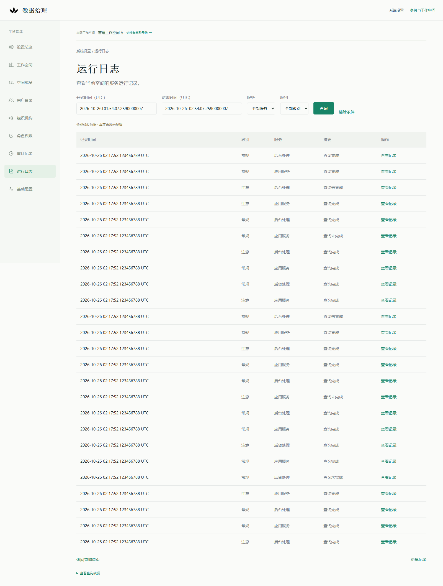
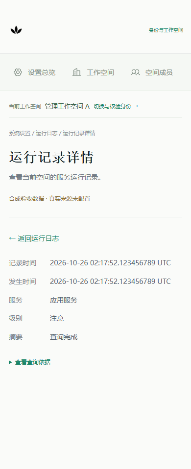

# 运行日志只读API与权限验收

2026-10-26，基线PR #363 `a14ffb965a0fb6455f2789e16edba0268144cb64`。本轮完成实际Next → Go HTTP → OIDC/RP及PostgreSQL当前权限 → 隔离合成来源的链路。真实来源仍UNCONFIGURED，PR保持Draft，不合并、不部署。

## 实施与边界

- `RuntimeLogHandler`提供来源状态、列表及精确详情三个GET接口，路径与字段由[权威契约](../architecture/platform-runtime-logs-readonly-v1.md)拥有。处理器挂在独立只读管理验收宿主，未为原主服务配置真实日志接入。
- migration 000078新增严格允许的`PLATFORM_RUNTIME_LOG_READ`资格，不改000077、不自动授予已有管理查询员。迁移只应用于本轮独立验收库；原库未运行DDL。
- OIDC解析、canonical actor、workspace grant、事务内`ValidateInTx`及现有IAM共享fence继续复用。来源状态只需管理读，列表/详情在同一个READ COMMITTED只读事务核对管理读与日志读；来源I/O之后再次解析身份、比较原issuer/subject/actor/workspace/revision并核对当前权限。I/O不持数据库事务，不用旧资格追认结果。
- `platform-management.v1`会话仍只投影原管理读权限。页面不再补造日志权，`runtimeLogAPI`只允许同源、当前空间的固定GET路径；角色名、导航来源及页面状态不授予读取资格。`from`、焦点等导航参数不进入日志API查询。
- 短时cursor及entryRef复用仓库已有`gorilla/securecookie v1.1.2`加密/MAC与用途隔离，绑定人员、空间、权限版本、来源/规则版本、固定窗口、位置或记录身份/hash及最短期限。rowKey使用标准HMAC作用域化。没有新增密码服务或引用账本；进程重启使引用失效。
- 查询保留UTC纳秒精度，以稳定发生身份处理同时间记录。来源读取受5秒上下文约束，列表/详情响应分别不超过256KiB/64KiB；无隐式重试。非完整页、重复/乱序、错空间、未知字段、过量或变化记录整次拒绝，错误不返回旧数据、原始错误或正文。

默认预览的IAM关闭路径仍传入null Reader，保持“运行日志尚未接入”。合成来源、控制端和网络Adapter只存在于tests；实际应用没有合成开启参数或真实来源配置入口。没有采集、tail、全文检索、导出、日志写入或运行任务动作。

## 复用说明

没有新建IAM、RBAC引擎、数据库日志表、索引库、队列或采集器。继续复用OIDC/RP成熟SDK、现有授权表/门禁、HTTP传输和新版设置流程。SecureCookie已经在依赖锁中，本轮只提升为直接引用，不升级版本或另造密码协议。Loki候选的[纸面准入结论](platform-runtime-logs-loki-admission-20261025.md)保持；其真实观察点、空间注入、稳定身份/续读及责任仍未证明，不能用合成HTTP Adapter替代证明。

## 独立环境与验证

本轮专用数据库`runtime_logs_readonly_20261026`、PG端口25550、API端口18550、合成IdP端口19150、Next端口4350。启动脚本只接受这一固定独立预设，已有目录/容器或占用端口时拒绝覆盖；不是生产来源配置。

运行时API角色只有必要身份表与审计表的SELECT，不能更新授权、插入审计或读取RP会话。RP角色仅能管理临时登录事务/会话，不能读取授权表。fixture准备和测试撤权使用独立库的专用admin资料，不交给API运行配置或页面。业务、模型与派发入口在该宿主中不存在。

| 验证 | 结果 |
|---|---|
| Go查询、受保护引用、分页/精确详情与状态测试 | PASS，含独立PostgreSQL双能力和读取中撤权回归 |
| `platformmanagement`及`principal/bindings`完整包回归 | 在本轮独立PG执行，PASS |
| 日志前端单元与Web独立包回归 | 11 PASS；包子进程清除父测试运行环境，并验证缺失依赖必须失败 |
| 完整前端构建 | 369 PASS / 2项可选PG用例SKIP，Next编译/类型/静态检查成功；Go的实际PG回归另行执行，未记作SKIP |
| 实际Next/API/OIDC/PG Edge链路 | 15 PASS |
| 默认Next设置入口 | 1 PASS，未发起管理数据API请求、无合成记录/写按钮 |
| 原有Agent、发布追溯、签收和归档Edge路线 | 15 PASS |

实际链路覆盖：独立管理/日志权限、原RP权限投影、58条同纳秒/相邻纳秒三页续读、详情刷新及后退/前进/返回原行、筛选重置、复制引用到其他人员/空间/过滤/用途、读取中数据库撤权、读取中OIDC撤销、grant与access token到期、重新授权不恢复旧引用、错空间/重复/正文/不完整/超大/失败来源、5秒取消、精确记录删除/变化、非法参数/GET body/Cookie/写方法，以及390px布局。查询前后审计业务数据hash一致；RP会话写入与测试授权变更单独存在于该独立库。

首轮API浏览器脚本在“空间切换后返回”断言失败：当时误要求合法的B空间查询也没有记录。既有契约要求返回当前空间并拒绝A的旧引用。已改为检查B空间当前结果、原记录不可见及详情引用移除，没有放宽服务端隔离规则；重跑15项全部通过。另修正了记录投影已变化且不再符合原筛选时的错误分类，按“结构核验→原投影比对→查询约束”判定为409记录变化；Go及带级别筛选的实际页面用例覆盖该路径。失败JSON保存在私有验收目录，不覆盖。

原4193/4493预览未重启；本轮只将新建4350页面及18550 API切到独立最终构建/二进制，按PID/启动时间/命令标记/监听归属核对后操作，旧ledger保留。原Q2容器身份与本轮准备前记录一致。原管理容器ID、挂载及状态保持；其历史resources.json启动时间早于一次既有重启，不把该旧时间当本轮before证据。实际接入代码与prepare严格限制新端口/新库，未连接原管理库执行SQL；CI预设另做两个保留容器的准备前后metadata核对。

[结果摘要](platform-runtime-logs-api-acceptance-20261026/results.json) · [截图与文件校验](platform-runtime-logs-api-acceptance-20261026/manifest.json)。证据JSON固定UTF-8/LF，核对Git对象和工作副本的相同字节/hash。PR CI以对应最新HEAD的检查和收口评论为准，不由本地结果推定。

CI在`c6991d25`发现[Go作业121375477895](https://github.com/qq550723504/data-product-platform/actions/runs/40261756345/job/121375477895)失败：trial-business当前候选仍精确固定schema77，新增只读权限迁移使当前DDL成为78。已审查迁移仅扩展日志资格CHECK，将当前候选精确pin更新为78；没有改成兼容范围/自动取latest，也没有改命令、状态迁移、原运行时或冻结记录。独立库上的整个trial-business/renewal回归通过，既有历史/幂等/并发门槛保留；运行的是合成工作空间单测，没有执行保留试点CLI。该回归的合成事实写入与只读API查询分开记录，不构成开启业务写入口。旧失败作业保持原FAIL结果，最新CI另行核对。

## 页面与重演

在明确获准的新独立工作副本中，设置 `MANAGEMENT_FIXTURE_ACK=ISOLATED_READONLY_MANAGEMENT`，运行 `python tests/platform-management/run.py --suite runtime`。原日志 API 与同宿主管理浏览器验收均由入口执行，结束后停止本轮容器与关联进程，保留数据、配置、日志、截图和原始失败证据。已有目标仍拒绝覆盖，不重置或延长旧身份会话；详见[验收收尾契约](../operations/acceptance-shutdown.md)。

统一入口内部执行原 `api-browser.mjs` 与同宿主管理验收；本地默认 Edge，CI 显式设置两个浏览器 channel 为 Chromium。原只读角色、业务全量摘要与独立浏览器上下文检查继续执行，不复用用户日常会话。

验收期间实际页面为`https://localhost:4350/settings/logs`，使用新建合成身份登录；引用及会话有期限，不是长期演示凭据。普通默认预览继续保持未接入。

## 停止点

真实人员/日志来源、业务空间责任方及来源证明仍未配置。没有Loki部署、真实来源Reader、采集服务、业务写API、模型或真实执行；未合并/部署，未改变业务历史事实。下一次真实接入需要独立确认来源范围和准入证据，不能由本轮CI或合成样例推定。
