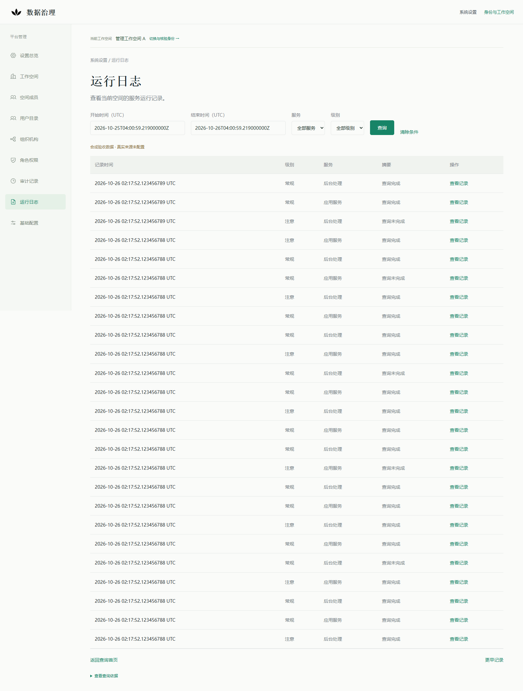
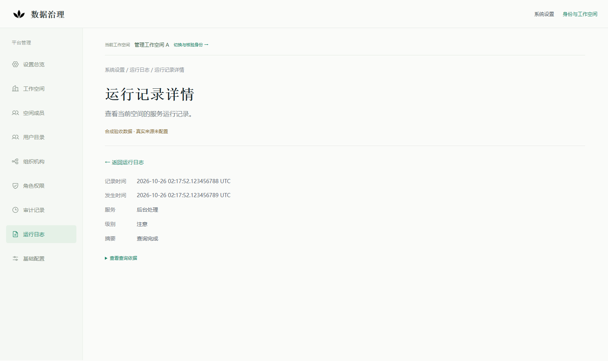
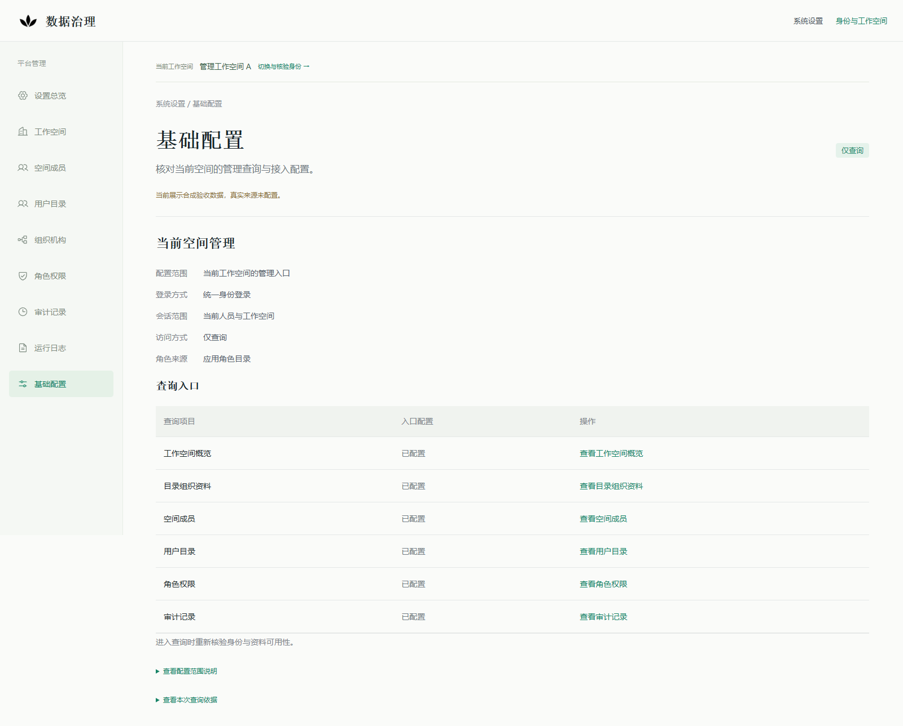
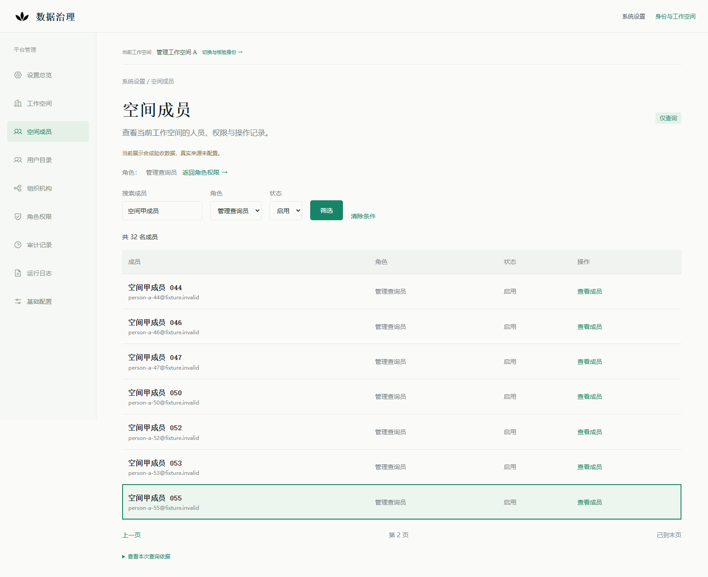

# 运行日志只读审查与系统设置整体验收

2026-10-26，PR #363 基线 `d9761107d04006076bd1a48ff751778fb52373be`。本轮限定为运行日志身份/双权限、跨空间、读取中撤权/到期、分页/详情引用的审查修复，以及系统设置整体只读验收。真实来源保持未配置；业务写入口关闭，PR 保持 Draft，不合并、不部署。

## 审查结论与修复

发现并修复三处边界问题；本轮授权范围内已知 blocker=0。规则由[运行日志权威契约](../architecture/platform-runtime-logs-readonly-v1.md)拥有，管理目录及角色/审计仍遵循[管理只读契约](../architecture/platform-management-readonly-v1.md)。

| 问题 | 修复与回归 |
|---|---|
| cursor/entryRef 在来源读取中到期，原处理器仍可能返回200及记录 | 来源读取、后置门禁和序列化后输出前重新检查原期限；到期返回409且无data，不能靠新引用续期。`TestRuntimeLogReferenceMustRemainValidThroughSourceRead`用局部时钟确定性覆盖cursor、详情及到期等值边界，不靠长时间sleep。 |
| 来源失败、记录不存在或变化时提前返回，跳过读取后的当前权限/来源版本核验 | 成功和错误观察共用后置身份、双权限与来源版本检查；撤权/到期时不披露存在或变化信息。新增12个组合单测、独立PG读取中grant到期回归，以及实际HTTP读取中撤权/令牌到期与来源失败组合验收。 |
| 合成Adapter将第26条多取记录截掉后才由处理器检查页，可能用非法记录证明还有下一页 | 抽取复用`ValidRuntimeBatch`，完整验证至多26条的身份、顺序、窗口/筛选及安全字段，再截成公开25条。TLS Adapter回归覆盖正常、重复、乱序、非法服务/级别/事件/时间及错空间。该修复限于已有Adapter边界，没有新采集器或真实来源Adapter。 |

三处均先运行失败回归，再验证修复；私有失败日志保留，未把旧FAIL改记为PASS。身份解析继续复用现有 uncached OIDC resolver、canonical actor、当前空间grant及同一只读事务内双能力门禁；没有新IAM、权限引擎、密码服务或来源表。原RP权限投影、来源状态仅需管理读、记录需要管理读和日志读的职责不变。没有修改migration、Agent API或业务状态机。

此机制仍不声称实现外部来源与PG之间的原子撤销。真实来源的可信空间注入、来源权限、稳定记录/分页与责任证据仍未确定，不能从合成Adapter推定。

## 当前验证

| 验证 | 本轮结果 |
|---|---|
| Go完整包：platformmanagement、合成Adapter、principal/bindings、principal/oidc | PASS；显式使用独立库`runtime_logs_readonly_20261026`，包含真实PG双权限与读取中到期回归 |
| 日志Web单元/独立包 | 11 PASS / 0 SKIP |
| 实际Next → Go → OIDC/RP → PG → 合成来源，独立Edge | 18 PASS |
| 同一日志API宿主上的系统设置整体，独立Edge | 51 PASS，含总览、成员、角色、用户、工作空间、组织、基础配置和审计 |
| IAM关闭的默认入口及原Agent/追溯/本地签收验收归档路线，独立Edge | 16 PASS，其中默认未接入入口1项、原有路线15项 |
| 原库容器、原管理容器与本轮独立PG的ID/状态/挂载/启动时间 | 本轮before/after一致 |
| 4193/4493原预览、4300原管理、19150合成IdP、4350现有Next监听归属 | 未变；仅18550本轮独立API切换到修复后二进制 |

18项实际链路覆盖默认一小时规范窗口和刷新、58条同纳秒/相邻纳秒三页续读、精确详情/返回/焦点、跨人员/空间/用途/过滤引用、读取中数据库撤权、读取中令牌撤销和到期、错误/消失/变化观察的后置门禁、来源异常/预算、非法参数/写方法及窄屏。短时引用读取中到期由确定性Go回归证明，不冒充浏览器等待期限测试。

51项设置验收复用既有完整流程，只增加固定的本轮独立fixture选择和同宿主回归，不调用原管理库。管理人员目录与日志源共用已有合成IdP；所有页面访问均由当前OIDC/RP身份重新核验。最终检查比较audit及execution、agent_task、agent_action_request、delivery_provider_attempt、outbox_event查询前后的条数/内容摘要；RP临时会话和测试身份授权变更单独核算。

本轮没有改变前端应用源码，因此复用已有独立Next构建；默认与保留路线使用另外启动的测试进程，所有业务动作开关关闭，仅连接测试合成HTTP来源，结束后由测试框架关闭。没有重启4193/4493、4300、4350或合成IdP。新API的切换核对了PID、启动时间、绝对可执行路径和监听归属，原ledger保留。

CI已增加在同一日志API宿主执行51项系统设置整体回归；仍使用有限结果/截图路径上传，不上传profile、会话库、配置、凭据或完整`.data`目录。本轮最新HEAD的最终CI结果以PR收口评论为准，不以本地结果或旧HEAD推定。

## 验收前提修正及保留失败

重演遇到三处验收前提问题，未放宽产品规则：

- 首次Edge运行时，前次验收的合成A授权已按一小时期限到期，页面拒绝读取。脚本现在在本轮独立库显式轮换该已知测试grant，重新登录；旧RP会话和引用仍因revision变化失效，没有延长原会话。
- 保留的合成记录已超出默认最近一小时。实际数据路线改为显式、固定的24小时以内窗口，并单独验证默认/清除条件确实恢复一小时；没有重写来源时间或重启IdP制造新记录。
- 设置整体最后一项原来假设库里业务表必为空；独立库已有先前trial-business单测产生的合成事实。改为查询前后逐表条数和内容摘要一致，既检查新增，也检查改写/删除，保留原事实。前50项通过及最后的`8 != 0`失败结果独立保存，没有清库解决测试。

私有记录位于`.data/runtime-logs-review-20261026`，另保留原有API验收与首次设置验收目录。公开[结果摘要](platform-runtime-logs-readonly-review-20261026/results.json)与[文件校验清单](platform-runtime-logs-readonly-review-20261026/manifest.json)不含这些私有配置或原始失败响应。

## 页面与重演

在新工作副本按[原API验收准备步骤](platform-runtime-logs-api-acceptance-20261026.md#页面与重演)创建独立fixture。准备脚本仍拒绝覆盖现有目录、容器或端口，不重置原库或现有身份环境。

1. 运行`node tests/runtime-logs/api-browser.mjs`，Windows默认独立Edge；可通过严格限定的`RUNTIME_LOG_BROWSER_OUTPUT`选择新的结果目录。其测试授权变更只允许固定25550端口/独立数据库，24小时之外的旧来源记录不能靠重置时钟恢复。
2. 设置`MANAGEMENT_RUNTIME_LOG_FIXTURE_ACK=ISOLATED_RUNTIME_LOG_READONLY`与新的`MANAGEMENT_BROWSER_OUTPUT=management-readonly-<验收名称>`，运行`node tests/platform-management/browser.mjs`，在同一4350页面和18550 API上执行51项设置验收。该选择只存在于tests，不是产品来源开关。
3. 前端和Go回归参见上表；CI还在原独立管理fixture上运行原51项用例，保留原路径验证。运行日志与设置脚本串行执行，避免两套撤权用例同时修改同一合成grant。

停止点：默认预览未接入，真实来源UNCONFIGURED；原库、OIDC/RP、新版预览和Agent API保留。业务写入口关闭，无模型、真实日志、采集服务或执行派发。Draft不合并；CI绿色不构成真实来源、写入、部署或合并授权。
