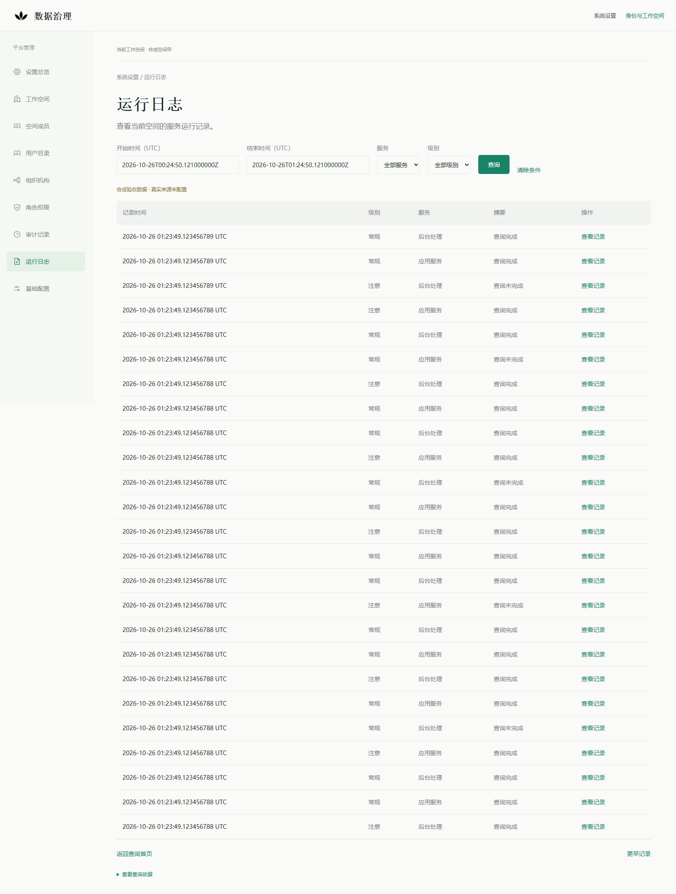
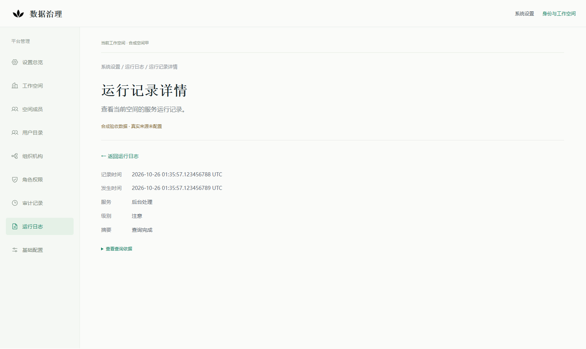
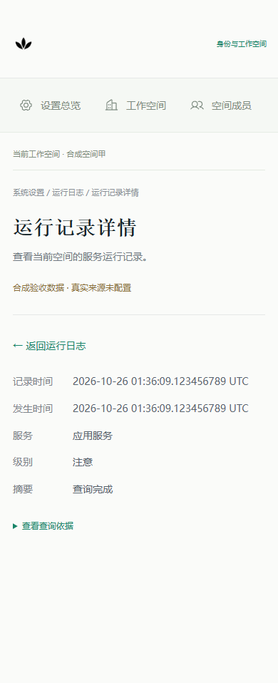

# 运行日志页面与独立合成验收

2026-10-26。基线：PR #363 `922940c86cda89ef343feb312f3fc8c9b8c356a1`。本轮交付共享页面和合成响应验证，真实来源仍为UNCONFIGURED。PR保持Draft，不合并、不部署。

## 交付和复用

- 复用新版系统设置壳、完整GET导航、查询表单、独立详情、返回原列表和焦点定位。设置壳提取为共享视图，原菜单、图标和业务入口保持。
- 查询保留明确UTC纳秒窗口、服务、级别；更早记录使用受保护位置引用。更改条件清除旧位置，刷新保持原窗口。第二页进入详情、刷新、历史导航和返回均保持条件及原行。
- 页面仅接受严格的最小字段和固定业务摘要；不展示原始正文、堆栈、地址、人员资料或来源自由错误。查询错误、未配置、无匹配、撤权、位置过期、记录删除与投影变化分别显示。
- 默认Next入口调用同一加载函数，Reader固定为null。URL、环境或角色名称均不能开启合成来源；没有新增生产配置开关、日志API、DDL或权限授予。
- `tests/runtime-logs`中的内存Reader、短时随机引用和HTTPS宿主只用于合成验收，不被应用导入。宿主复用现有OIDC/RP SDK与合成IdP测试设施、MemoryStore及共享页面；合成日志资格单独建模，不扩展实际`platform-management.v1`或现有管理查询员权限。

Build-vs-Buy沿用[权威契约](../architecture/platform-runtime-logs-readonly-v1.md#2-reuse-check与开源边界)：本轮没有采集、存储、索引或新密码设施；成熟OIDC/RP、React和Playwright继续复用。Loki仍是未准入的纸面候选，合成Reader的稳定身份、时间与分页不能补足其真实接入证明。

## 实际验证

| 验证 | 结果 | 证据范围 |
|---|---|---|
| 日志查询/投影单元测试 | 9 PASS | 纳秒窗口、58条续读、条件与焦点恢复、跨空间/人员、读取中撤权/版本变化、严格投影及异常恢复 |
| 独立Edge合成页面 | 16 PASS，0重试/跳过 | 同一共享页面和加载器；本机临时TLS宿主、合成IdP及内存来源 |
| 实际Next默认入口Edge验收 | 1 PASS | 通过全部设置菜单，日志保持未接入；无管理数据API请求、记录表格或写按钮，390px无整页溢出 |
| 原有路线Edge回归 | 15 PASS | Agent质量读取、历史报告、修复计划入口、发布追溯、签收/补正/撤回/取消/验收/归档与跨空间演示历史 |
| 全量前端构建 | PASS | 当次366项单元PASS、2项可选PG测试SKIP，Next编译/类型/静态检查成功；其后新增的读取中来源版本回归包含在上列9项中 |
| 保留预览进程 | 身份核对一致 | 4193/4493的PID、启动时间、命令标记和监听归属与原ledger一致；没有重启或替换保留构建 |

证据JSON按仓库既有做法固定为UTF-8/LF，并同时核对工作副本与Git对象的字节/hash，避免Windows换行转换改变清单。

浏览器结果与截图：[结果摘要](platform-runtime-logs-synthetic-acceptance-20261026/results.json)、[文件校验清单](platform-runtime-logs-synthetic-acceptance-20261026/manifest.json)。测试使用Edge的`msedge`通道；CI使用其已有Chromium安装执行同组用例。PR CI结果以对应HEAD的GitHub检查为准，不能由本地结果推定。

首轮Edge为11 PASS / 5 FAIL：返回箭头进入可访问名称导致2个用例失败；另3个只在测试结束清理HTTPS连接时超时，断言已通过。已将装饰箭头设为辅助技术忽略，并在测试专属宿主/IdP清理时关闭其自有连接；完整重跑16 PASS。首轮结果和trace仍保留在私有`.data/runtime-logs-20261026/failed-first-run*`。

首次Next构建发现BigInt字面量不符合项目ES2017编译目标；改为等价BigInt构造，纳秒值不转换成浮点Number，也不降低时间精度。日志单元编译目标现与项目一致，重建成功；失败构建日志保留，现有CSS的autoprefixer提示不作为新增失败。

## 矩阵覆盖和未验证范围

| 原规格 | 本轮覆盖 |
|---|---|
| RL01–RL05 | 未配置、双资格模型、跨空间、跨人员、RP撤销/版本失效、合成日志资格撤销、来源版本切换。真实PG双能力事务和原生来源撤权仍未实施/NOT_RUN |
| RL06 | 58个独立发生，含28条相同纳秒及其余相邻纳秒，三页25/25/8，不按正文或毫秒去重；仅证明合成Reader模型，不证明Loki原生续读 |
| RL07–RL08 | 严格字段、错误空间/版本、重复/超量/非法时间、正文/stack注入拒绝；没有真实来源I/O，5秒取消、原生截断及真实响应预算仍NOT_RUN |
| RL09–RL11 | 第二页→详情→刷新→后退/前进→返回原行，筛选重置、固定时间窗、引用过期与人工重查；原生绑定/密钥轮转见证仍NOT_RUN |
| RL12–RL14 | 无匹配、异常、删除、同身份内容变化、空间切换、390px和返回焦点；真实保留期/删除行为仍NOT_RUN |
| RL15 | 测试宿主拒绝POST/DELETE/PATCH、原生选择器和伪造Authorization；应用无日志API/生产Reader，未证明一个尚未实施的后端接口可用 |
| RL16 | 当次实际Next默认入口及15条保留路线通过；原独立PG管理51项不是本轮本地重跑结果，另由既有CI流程执行其回归 |

本轮没有连接原库、实际人员目录、真实日志、模型或执行设施。临时宿主没有数据库客户端、业务Command、任务派发或采集服务；其来源状态、空间、权限和记录均为完全合成。合成IdP只证明这组RP SDK会话验证，不替代真实身份源或正式PG事务门禁验收。日志页面、截图与查询引用均不构成审计事实、签收或业务验收通过。

## 截图与重演

在独立工作副本中沿用锁定依赖；不覆盖运行中预览的构建目录：

1. `npm --prefix apps/web run test:iam`，再执行`npm --prefix apps/web run test:runtime-logs`。
2. `node tests/runtime-logs/run.mjs`。Windows默认独立Edge，CI显式设`RUNTIME_LOG_BROWSER_CHANNEL=chromium`。每次生成进程专用的临时TLS资料，不安装系统证书；结束时只清理自有连接与临时目录。
3. 需要实际Next回归时，先按已有隔离构建方式为`NEXT_DIST_DIR`生成独立构建，然后设置相同目录，运行`node tests/browser/node_modules/@playwright/test/cli.js test --config tests/runtime-logs/default-preview.config.mjs`与`retained-routes.config.mjs`。这两个本地配置使用Edge及既有本机合成fixture，不复用/停止4193或4300。当前CI在已有实际Next构建后运行默认入口用例和新增合成日志用例。
4. 打开报告确认16/1/15项结果；按截图依次走第二页、查看记录、刷新和返回。引用按人员、空间、版本、来源和期限绑定，不能跨会话复制作为长期重演依据。

下一停止点：真实来源、producer、稳定记录身份/观察点/续读、只读范围和责任方未明确前，继续保持未接入。原库、OIDC/RP、Agent API和业务历史保持；业务写入、模型、真实执行关闭。
